# PLATO-40 data audit

Generated by `make audit DATA=<data_root>` (`plato40 audit <data_root> --out reports/audit`). Do not edit by hand: every number below is computed by `src/plato40/audit/`. Rerunning on the same data reproduces this file and its figures byte for byte.

Datasets: `PLATO40_v2_quickstart` (quickstart), `PLATO40_v2_dev` (dev). They are independent synthetic runs and are analysed separately, never concatenated. Python 3.12.3, pandas 3.1.1, numpy 2.5.4, matplotlib 3.11.2.

Conventions: times are UTC unless marked local (Europe/Vienna). Blank fields are missing, never zero. Episodes named here are *candidates* found by screening rules, not detections. Each subsection states its hypothesis first, then what the data shows.

## 1. Inventory

Hypothesis: every file matches the column list in the dataset README, telemetry is on a 15-minute grid, hourly series (tariff, logistics) on a 60-minute grid, and each file has a natural primary key with no duplicates.

### 1.1 `quickstart` (PLATO40_v2_quickstart)

Manifest: 2026-01-05T00:00:00Z to 2026-01-26T00:00:00Z (21 d), interval 900 s, dataset version 2.0.0-dev.

| file | rows | cols | time range (UTC) | median step (min) | key | duplicate keys |
|---|---|---|---|---|---|---|
| `bookings.csv` | 281 | 8 | 2026-01-02T14:00Z .. 2026-01-26T14:00Z | irregular | booking_id | 0 |
| `access_log.csv` | 3,787 | 4 | 2026-01-05T01:04Z .. 2026-01-25T22:16Z | irregular | timestamp_utc, door_id, credential | 0 |
| `room_telemetry.csv` | 80,642 | 9 | 2026-01-05T00:00Z .. 2026-01-25T23:45Z | 15 | timestamp_utc, room_id | 2 |
| `room_water.csv` | 80,640 | 3 | 2026-01-05T00:00Z .. 2026-01-25T23:45Z | 15 | timestamp_utc, room_id | 0 |
| `water_main.csv` | 2,016 | 2 | 2026-01-05T00:00Z .. 2026-01-25T23:45Z | 15 | timestamp_utc | 0 |
| `energy.csv` | 2,016 | 8 | 2026-01-05T00:00Z .. 2026-01-25T23:45Z | 15 | timestamp_utc | 0 |
| `weather.csv` | 2,016 | 3 | 2026-01-05T00:00Z .. 2026-01-25T23:45Z | 15 | timestamp_utc | 0 |
| `weather_forecast.csv` | 972 | 3 | 2026-01-05T06:00Z .. 2026-01-25T23:00Z | irregular | issued_utc, target_utc | 0 |
| `tariff.csv` | 504 | 3 | 2026-01-05T00:00Z .. 2026-01-25T23:00Z | 60 | timestamp_utc | 0 |
| `equipment.csv` | 16,128 | 4 | 2026-01-05T00:00Z .. 2026-01-25T23:45Z | 15 | timestamp_utc, asset_id, metric | 0 |
| `logistics.csv` | 3,528 | 4 | 2026-01-05T00:00Z .. 2026-01-25T23:00Z | 60 | timestamp_utc, asset_id, metric | 0 |
| `staff_roster.csv` | 102 | 7 | 2026-01-05T05:00Z .. 2026-01-25T06:00Z | irregular | shift_id | 0 |
| `work_orders.csv` | 9 | 9 | 2026-01-08T09:00Z .. 2026-01-25T23:30Z | irregular | work_order_id | 0 |
| `guest_requests.csv` | 112 | 11 | 2026-01-05T09:10Z .. 2026-01-25T18:16Z | irregular | request_id | 0 |
| `events.jsonl` | 1,406 | 11 | 2026-01-05T00:00Z .. 2026-01-25T16:30Z | irregular | event_id | 0 |

All headers match the declared schema; every non-empty value parsed.

Differences between data and documentation:

- README event types absent from this dataset: room_reassigned, vending_out_of_stock, waste_bin_full.
- building.json lists HP1 metric(s) cop that never appear in equipment.csv.
- HP1 status codes beyond the documented running/standby/defrost: lockout_high_pressure (README allows other codes).
- BAT1 SOC observed 10.0..60.0 kWh vs declared bounds 10..95 kWh.

### 1.2 `dev` (PLATO40_v2_dev)

Manifest: 2026-01-01T00:00:00Z to 2027-01-01T00:00:00Z (365 d), interval 900 s, dataset version 2.0.0-dev.

| file | rows | cols | time range (UTC) | median step (min) | key | duplicate keys |
|---|---|---|---|---|---|---|
| `bookings.csv` | 4,088 | 8 | 2025-12-29T14:00Z .. 2027-01-01T14:00Z | irregular | booking_id | 0 |
| `access_log.csv` | 67,557 | 4 | 2026-01-01T01:38Z .. 2026-12-31T23:26Z | irregular | timestamp_utc, door_id, credential | 0 |
| `room_telemetry.csv` | 1,401,640 | 9 | 2026-01-01T00:00Z .. 2026-12-31T23:45Z | 15 | timestamp_utc, room_id | 40 |
| `room_water.csv` | 1,401,600 | 3 | 2026-01-01T00:00Z .. 2026-12-31T23:45Z | 15 | timestamp_utc, room_id | 0 |
| `water_main.csv` | 35,040 | 2 | 2026-01-01T00:00Z .. 2026-12-31T23:45Z | 15 | timestamp_utc | 0 |
| `energy.csv` | 35,040 | 8 | 2026-01-01T00:00Z .. 2026-12-31T23:45Z | 15 | timestamp_utc | 0 |
| `weather.csv` | 35,040 | 3 | 2026-01-01T00:00Z .. 2026-12-31T23:45Z | 15 | timestamp_utc | 0 |
| `weather_forecast.csv` | 17,484 | 3 | 2026-01-01T06:00Z .. 2026-12-31T23:00Z | irregular | issued_utc, target_utc | 0 |
| `tariff.csv` | 8,760 | 3 | 2026-01-01T00:00Z .. 2026-12-31T23:00Z | 60 | timestamp_utc | 0 |
| `equipment.csv` | 280,320 | 4 | 2026-01-01T00:00Z .. 2026-12-31T23:45Z | 15 | timestamp_utc, asset_id, metric | 0 |
| `logistics.csv` | 61,320 | 4 | 2026-01-01T00:00Z .. 2026-12-31T23:00Z | 60 | timestamp_utc, asset_id, metric | 0 |
| `staff_roster.csv` | 1,760 | 7 | 2026-01-01T05:00Z .. 2026-12-31T07:00Z | irregular | shift_id | 0 |
| `work_orders.csv` | 76 | 9 | 2026-01-11T09:00Z .. 2026-12-30T18:00Z | irregular | work_order_id | 0 |
| `guest_requests.csv` | 1,612 | 11 | 2026-01-01T14:03Z .. 2026-12-31T22:57Z | irregular | request_id | 0 |
| `events.jsonl` | 22,744 | 14 | 2026-01-01T00:00Z .. 2026-12-31T20:15Z | irregular | event_id | 0 |

All headers match the declared schema; every non-empty value parsed.

Differences between data and documentation:

- README event types absent from this dataset: oncall_housekeeping_called.
- building.json lists HP1 metric(s) cop that never appear in equipment.csv.
- HP1 status codes beyond the documented running/standby/defrost: lockout_high_pressure (README allows other codes).
- BAT1 SOC observed 10.0..95.0 kWh vs declared bounds 10..95 kWh.

Column types after loading (identical for all datasets; blank = missing):

Column table

| file | column | declared | loaded dtype |
|---|---|---|---|
| `bookings.csv` | `booking_id` | text | str |
| `bookings.csv` | `room_id` | text | str |
| `bookings.csv` | `created_utc` | timestamp_utc | datetime64[us, UTC] |
| `bookings.csv` | `arrival_utc` | timestamp_utc | datetime64[us, UTC] |
| `bookings.csv` | `departure_utc` | timestamp_utc | datetime64[us, UTC] |
| `bookings.csv` | `guest_count` | int | Int64 |
| `bookings.csv` | `channel` | text | str |
| `bookings.csv` | `status` | text | str |
| `access_log.csv` | `timestamp_utc` | timestamp_utc | datetime64[us, UTC] |
| `access_log.csv` | `door_id` | text | str |
| `access_log.csv` | `credential` | text | str |
| `access_log.csv` | `result` | text | str |
| `room_telemetry.csv` | `timestamp_utc` | timestamp_utc | datetime64[us, UTC] |
| `room_telemetry.csv` | `room_id` | text | str |
| `room_telemetry.csv` | `temperature_c` | float | float64 |
| `room_telemetry.csv` | `setpoint_c` | float | float64 |
| `room_telemetry.csv` | `humidity_pct` | float | float64 |
| `room_telemetry.csv` | `co2_ppm` | float | float64 |
| `room_telemetry.csv` | `presence` | flag_0_1 | float64 |
| `room_telemetry.csv` | `window_open` | flag_0_1 | float64 |
| `room_telemetry.csv` | `housekeeping_state` | text | str |
| `room_water.csv` | `timestamp_utc` | timestamp_utc | datetime64[us, UTC] |
| `room_water.csv` | `room_id` | text | str |
| `room_water.csv` | `meter_total_l` | float | float64 |
| `water_main.csv` | `timestamp_utc` | timestamp_utc | datetime64[us, UTC] |
| `water_main.csv` | `meter_total_l` | float | float64 |
| `energy.csv` | `timestamp_utc` | timestamp_utc | datetime64[us, UTC] |
| `energy.csv` | `building_load_kw` | float | float64 |
| `energy.csv` | `hvac_electric_kw` | float | float64 |
| `energy.csv` | `pv_kw` | float | float64 |
| `energy.csv` | `battery_discharge_kw_signed` | float | float64 |
| `energy.csv` | `battery_soc_kwh` | float | float64 |
| `energy.csv` | `grid_import_kw` | float | float64 |
| `energy.csv` | `grid_export_kw` | float | float64 |
| `weather.csv` | `timestamp_utc` | timestamp_utc | datetime64[us, UTC] |
| `weather.csv` | `outdoor_c` | float | float64 |
| `weather.csv` | `cloud_cover_pct` | float | float64 |
| `weather_forecast.csv` | `issued_utc` | timestamp_utc | datetime64[us, UTC] |
| `weather_forecast.csv` | `target_utc` | timestamp_utc | datetime64[us, UTC] |
| `weather_forecast.csv` | `outdoor_c_forecast` | float | float64 |
| `tariff.csv` | `timestamp_utc` | timestamp_utc | datetime64[us, UTC] |
| `tariff.csv` | `price_eur_kwh` | float | float64 |
| `tariff.csv` | `published_utc` | timestamp_utc | datetime64[us, UTC] |
| `equipment.csv` | `timestamp_utc` | timestamp_utc | datetime64[us, UTC] |
| `equipment.csv` | `asset_id` | text | str |
| `equipment.csv` | `metric` | text | str |
| `equipment.csv` | `value` | mixed | str |
| `logistics.csv` | `timestamp_utc` | timestamp_utc | datetime64[us, UTC] |
| `logistics.csv` | `asset_id` | text | str |
| `logistics.csv` | `metric` | text | str |
| `logistics.csv` | `value` | float | float64 |
| `staff_roster.csv` | `shift_id` | text | str |
| `staff_roster.csv` | `resource_id` | text | str |
| `staff_roster.csv` | `role` | text | str |
| `staff_roster.csv` | `start_utc` | timestamp_utc | datetime64[us, UTC] |
| `staff_roster.csv` | `end_utc` | timestamp_utc | datetime64[us, UTC] |
| `staff_roster.csv` | `status` | text | str |
| `staff_roster.csv` | `status_known_utc` | timestamp_utc | datetime64[us, UTC] |
| `work_orders.csv` | `work_order_id` | text | str |
| `work_orders.csv` | `created_utc` | timestamp_utc | datetime64[us, UTC] |
| `work_orders.csv` | `asset_id` | text | str |
| `work_orders.csv` | `type` | text | str |
| `work_orders.csv` | `status` | text | str |
| `work_orders.csv` | `scheduled_utc` | timestamp_utc | datetime64[us, UTC] |
| `work_orders.csv` | `completed_utc` | timestamp_utc | datetime64[us, UTC] |
| `work_orders.csv` | `assigned_to` | text | str |
| `work_orders.csv` | `summary` | text | str |
| `guest_requests.csv` | `request_id` | text | str |
| `guest_requests.csv` | `timestamp_utc` | timestamp_utc | datetime64[us, UTC] |
| `guest_requests.csv` | `room_id` | text | str |
| `guest_requests.csv` | `booking_id` | text | str |
| `guest_requests.csv` | `channel` | text | str |
| `guest_requests.csv` | `language` | text | str |
| `guest_requests.csv` | `request_type` | text | str |
| `guest_requests.csv` | `text` | text | str |
| `guest_requests.csv` | `priority` | text | str |
| `guest_requests.csv` | `response_due_utc` | timestamp_utc | datetime64[us, UTC] |
| `guest_requests.csv` | `requires_guest_consent` | text | str |

Units (from `manifest.json`): temperature = degC; power = kW; energy_storage = kWh; water = L (cumulative meter readings); price = EUR/kWh incl. grid fees; co2 = ppm; humidity = %.

Known limitations stated by `manifest.json`:

- Fictional building; not a real PLATO site or CLARA export
- Simplified, uncalibrated thermal/HVAC/water models
- Offline replay: proposed actions do not change later observations
- BMS alarms are rule-based, delayed, incomplete and can be false
- Guest messages are synthetic; no message is ever delivered or answered in the data

Documentation files are byte-identical across datasets when the digests match:

| file | quickstart | dev |
|---|---|---|
| `README.md` | b7ddfff2d89c | b7ddfff2d89c |
| `DECISION_CONTRACT.md` | 8a4b6f9fa696 | 8a4b6f9fa696 |
| `CHALLENGE.md` | c687a570e25e | c687a570e25e |

### 1.3 Decision contract

`DECISION_CONTRACT.md` is shipped inside every dataset directory (`<data_dir>/DECISION_CONTRACT.md`). It defines 8 required fields: `event_id`, `timestamp_utc`, `affected_assets`, `issue_type`, `action`, `priority`, `reason`, `requires_human_approval`. It recommends 10 optional fields: `autonomy`, `episode_id`, `evidence`, `expected_outcome`, `verification_plan`, `dependencies`, `guest_request_ids`, `requires_guest_consent`, `resource_id`, `confidence`. The action vocabulary has 14 verbs: `schedule_cleaning`, `dispatch_robot`, `adjust_room_setpoint`, `optimize_energy`, `block_room`, `release_room`, `reassign_room`, `request_inspection`, `dispatch_technician`, `order_service`, `notify_guest`, `flag_anomaly`, `defer_action`, `request_human_approval`. Other verbs are allowed if documented in our README. Two rules matter for design: the decision `timestamp_utc` must only use information available at that time, and a consent requirement or a proposed message is never evidence of consent or delivery.

## 2. Data quality

Hypotheses: (a) missing data comes in two forms, single-sensor dropouts and gateway outages that blank a whole floor; (b) a few implausible spikes exist and are isolated; (c) duplicates are exact copies; (d) meter resets coincide with metering work orders; (e) all timestamps are UTC and local operations follow Europe/Vienna including DST.

### 2.1 `quickstart`

Missing values per column (blank field = missing):

| file | column | missing | share (%) |
|---|---|---|---|
| `room_telemetry.csv` | `temperature_c` | 473 | 0.59 |
| `room_telemetry.csv` | `setpoint_c` | 210 | 0.26 |
| `room_telemetry.csv` | `humidity_pct` | 614 | 0.76 |
| `room_telemetry.csv` | `co2_ppm` | 694 | 0.86 |
| `room_telemetry.csv` | `presence` | 370 | 0.46 |
| `room_telemetry.csv` | `window_open` | 371 | 0.46 |
| `room_telemetry.csv` | `housekeeping_state` | 210 | 0.26 |
| `room_water.csv` | `meter_total_l` | 368 | 0.46 |
| `equipment.csv` | `value` | 419 | 2.60 |
| `equipment.csv` | `value` (AHU1/filter_dp_pa) | 404 | 20.04 |
| `equipment.csv` | `value` (HP1/supply_temp_c) | 15 | 0.74 |

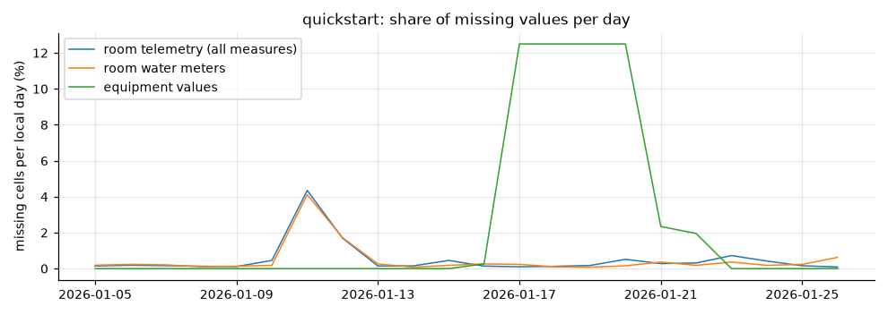

*quickstart: missing values per day*

Whole-row telemetry outages (all measures blank): 2 episodes, total 5.2 h. In 2 of them all 10 rooms of one floor are blank at the same time, the signature of a floor gateway (`GW_F1`..`GW_F4`) rather than individual sensors. Remaining single-column gaps are sensor dropouts.

Outage episodes

| floor | start (UTC) | end (UTC) | hours | rooms out |
|---|---|---|---|---|
| F3 | 2026-01-11T02:15Z | 2026-01-11T04:00Z | 2.00 | 10 |
| F3 | 2026-01-11T21:15Z | 2026-01-12T00:15Z | 3.25 | 10 |

Equipment gaps of 2 h or longer: 2.

| series | start (UTC) | end (UTC) | hours |
|---|---|---|---|
| AHU1/filter_dp_pa | 2026-01-16T22:30Z | 2026-01-21T03:15Z | 101.00 |
| HP1/supply_temp_c | 2026-01-22T13:00Z | 2026-01-22T16:30Z | 3.75 |

Plausibility (bounds are our assumptions, see `src/plato40/load/units.py`):

| series | unit | bounds | below | above | observed range |
|---|---|---|---|---|---|
| `room_telemetry.csv` temperature_c | degC | 5.0..40.0 | 0 | 1 | 11.68..85.00 |
| `room_telemetry.csv` setpoint_c | degC | 15.0..26.0 | 0 | 0 | 18.00..24.00 |
| `room_telemetry.csv` humidity_pct | % | 5.0..95.0 | 0 | 0 | 27.30..64.50 |
| `room_telemetry.csv` co2_ppm | ppm | 350.0..5,000 | 0 | 0 | 374.00..1,005 |
| `room_telemetry.csv` presence | 0/1 | 0.0..1.0 | 0 | 0 | 0.00..1.00 |
| `room_telemetry.csv` window_open | 0/1 | 0.0..1.0 | 0 | 0 | 0.00..1.00 |
| `energy.csv` building_load_kw | kW | 0.0..200.0 | 0 | 0 | 12.50..59.29 |
| `energy.csv` hvac_electric_kw | kW | 0.0..70.0 | 0 | 0 | 0.30..44.67 |
| `energy.csv` pv_kw | kW | 0.0..60.0 | 0 | 0 | 0.00..16.90 |
| `energy.csv` battery_discharge_kw_signed | kW | -40.0..40.0 | 0 | 0 | -20.00..40.00 |
| `energy.csv` battery_soc_kwh | kWh | 0.0..100.0 | 0 | 0 | 10.00..60.00 |
| `energy.csv` grid_import_kw | kW | 0.0..250.0 | 0 | 0 | 0.00..72.66 |
| `energy.csv` grid_export_kw | kW | 0.0..100.0 | 0 | 0 | 0.00..0.00 |
| `weather.csv` outdoor_c | degC | -30.0..42.0 | 0 | 0 | -19.40..8.30 |
| `weather.csv` cloud_cover_pct | % | 0.0..100.0 | 0 | 0 | 0.00..100.00 |
| `weather_forecast.csv` outdoor_c_forecast | degC | -30.0..42.0 | 0 | 0 | -29.83..11.86 |
| `tariff.csv` price_eur_kwh | EUR/kWh | -0.5..2.0 | 0 | 0 | 0.18..0.36 |
| `equipment.csv` HP1/heat_output_kw | kW | 0.0..120.0 | 3 | 0 | -0.25..76.68 |
| `equipment.csv` HP1/electric_kw | kW | 0.0..70.0 | 0 | 0 | 0.17..44.82 |
| `equipment.csv` HP1/supply_temp_c | degC | 15.0..75.0 | 0 | 0 | 35.40..51.10 |
| `equipment.csv` AHU1/airflow_m3h | m3/h | 0.0..5,500 | 0 | 0 | 2,482..4,302 |
| `equipment.csv` AHU1/filter_dp_pa | Pa | 0.0..600.0 | 0 | 0 | 36.40..288.00 |
| `equipment.csv` AHU1/fan_kw | kW | 0.0..10.0 | 0 | 0 | 0.97..5.47 |
| `equipment.csv` AHU1/supply_air_c | degC | 5.0..40.0 | 0 | 0 | 18.80..20.40 |
| `logistics.csv` fill_pct | % | 0.0..100.0 | 0 | 0 | 0.00..76.20 |
| `logistics.csv` stock_drinks | units | 0.0..100.0 | 0 | 0 | 30.00..100.00 |
| `logistics.csv` stock_snacks | units | 0.0..60.0 | 0 | 0 | 21.00..60.00 |

Out-of-bounds room temperatures (first rows). Distinct out-of-bounds values: 85.0. Exact round values far outside the physical range look like sensor error codes rather than measurements:

| time (UTC) | room | temperature_c | setpoint_c |
|---|---|---|---|
| 2026-01-24T15:45Z | R106 | 85.00 | 23.0 |

15-minute water volumes above bounds: rooms 0 (> 300 L), main 0 (> 3,000 L).

Frozen values (identical reading for 3 h or more): room temperature 1 runs in 1 rooms, longest 23.2 h; equipment 0 runs.

| room | start (UTC) | end (UTC) | hours | value (degC) |
|---|---|---|---|---|
| R205 | 2026-01-12T13:00Z | 2026-01-13T12:00Z | 23.25 | 17.95 |

Duplicate primary keys:

| file | duplicate rows | with conflicting values | first at |
|---|---|---|---|
| `room_telemetry.csv` | 2 | 0 | 2026-01-12T07:00Z |

Timestamps earlier than the previous row of the same series, in file order:

| file | violations |
|---|---|
| `room_telemetry.csv` | 0 |
| `room_water.csv` | 0 |
| `water_main.csv` | 0 |
| `energy.csv` | 0 |
| `weather.csv` | 0 |
| `tariff.csv` | 0 |
| `equipment.csv` | 0 |
| `logistics.csv` | 0 |
| `events.jsonl` | 0 |

Cumulative meter resets (drop > 1,000 L): 1. Metering work orders: 1.

| meter | time (UTC) | drop (L) |
|---|---|---|
| R403 | 2026-01-18T05:15Z | 27,020.4 |

| work order | asset | scheduled (UTC) | completed (UTC) |
|---|---|---|---|
| WO00004 | WM_R403 | 2026-01-18T05:15Z | 2026-01-18T05:30Z |

Smaller negative steps (meter jitter), by meter:

| meter | negative steps | sum (L) | first (UTC) |
|---|---|---|---|
| R403 | 337 | -346.7 | 2026-01-18T05:45Z |

Energy balance residual (README identity): median 0.000 kW, |residual| > 0.5 kW in 0 of 2,016 intervals, max |residual| 0.00 kW.

Categorical values as observed (a documented value that never occurs is absent here, e.g. `inspection_required`):

| column | values (count) |
|---|---|
| `room_telemetry.csv` housekeeping_state | clean 78,076, dirty 1,729, in_progress 627, (missing) 210 |
| `bookings.csv` status | confirmed 263, cancelled 18 |
| `bookings.csv` channel | ota 114, direct_web 107, corporate 51, phone 9 |
| `staff_roster.csv` status | scheduled 93, vacation 5, sick 4 |
| `access_log.csv` result | granted 3,787 |
| `work_orders.csv` type | corrective 7, preventive 1, metering 1 |
| `work_orders.csv` status | completed 9 |
| `guest_requests.csv` requires_guest_consent | not_required 79, required 33 |
| `equipment.csv` HP1 status | running 1,963, defrost 48, lockout_high_pressure 5 |

Time zones. Share of raw timestamp strings that end in `Z` (UTC):

| column | ends in Z (%) |
|---|---|
| `bookings.csv` created_utc | 100.00 |
| `bookings.csv` arrival_utc | 100.00 |
| `bookings.csv` departure_utc | 100.00 |
| `access_log.csv` timestamp_utc | 100.00 |
| `room_telemetry.csv` timestamp_utc | 100.00 |
| `room_water.csv` timestamp_utc | 100.00 |
| `water_main.csv` timestamp_utc | 100.00 |
| `energy.csv` timestamp_utc | 100.00 |
| `weather.csv` timestamp_utc | 100.00 |
| `weather_forecast.csv` issued_utc | 100.00 |
| `weather_forecast.csv` target_utc | 100.00 |
| `tariff.csv` timestamp_utc | 100.00 |
| `tariff.csv` published_utc | 100.00 |
| `equipment.csv` timestamp_utc | 100.00 |
| `logistics.csv` timestamp_utc | 100.00 |
| `staff_roster.csv` start_utc | 100.00 |
| `staff_roster.csv` end_utc | 100.00 |
| `staff_roster.csv` status_known_utc | 100.00 |
| `work_orders.csv` created_utc | 100.00 |
| `work_orders.csv` scheduled_utc | 100.00 |
| `work_orders.csv` completed_utc | 100.00 |
| `guest_requests.csv` timestamp_utc | 100.00 |
| `guest_requests.csv` response_due_utc | 100.00 |

Local-clock regularities (top three values, count in brackets). One local value with two UTC values means the source follows Europe/Vienna across daylight saving time; consumers must convert, not assume a fixed offset:

| series | local (Europe/Vienna) | UTC |
|---|---|---|
| booking arrival_utc | 15:00 (281) | 14:00 (281) |
| booking departure_utc | 11:00 (281) | 10:00 (281) |
| tariff published_utc | 13:00 (504) | 12:00 (504) |
| forecast issued_utc | 06:00 (972) | 05:00 (972) |
| cleaner shift start_utc | 07:00 (45) | 06:00 (45) |
| technician shift start_utc | 08:00 (15) | 07:00 (15) |
| waste_pickup events | 07:00 (6) | 06:00 (6) |

### 2.2 `dev`

Missing values per column (blank field = missing):

| file | column | missing | share (%) |
|---|---|---|---|
| `room_telemetry.csv` | `temperature_c` | 7,240 | 0.52 |
| `room_telemetry.csv` | `setpoint_c` | 2,470 | 0.18 |
| `room_telemetry.csv` | `humidity_pct` | 6,891 | 0.49 |
| `room_telemetry.csv` | `co2_ppm` | 6,810 | 0.49 |
| `room_telemetry.csv` | `presence` | 6,475 | 0.46 |
| `room_telemetry.csv` | `window_open` | 5,260 | 0.38 |
| `room_telemetry.csv` | `housekeeping_state` | 2,470 | 0.18 |
| `room_water.csv` | `meter_total_l` | 5,267 | 0.38 |
| `equipment.csv` | `value` | 1,169 | 0.42 |
| `work_orders.csv` | `completed_utc` | 2 | 2.63 |
| `equipment.csv` | `value` (AHU1/airflow_m3h) | 119 | 0.34 |
| `equipment.csv` | `value` (AHU1/filter_dp_pa) | 935 | 2.67 |
| `equipment.csv` | `value` (HP1/heat_output_kw) | 27 | 0.08 |
| `equipment.csv` | `value` (HP1/supply_temp_c) | 88 | 0.25 |

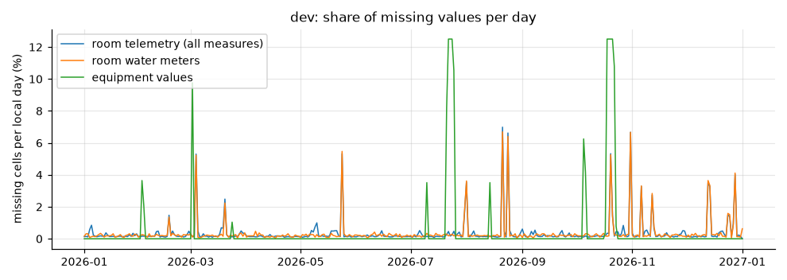

*dev: missing values per day*

Whole-row telemetry outages (all measures blank): 14 episodes, total 61.8 h. In 14 of them all 10 rooms of one floor are blank at the same time, the signature of a floor gateway (`GW_F1`..`GW_F4`) rather than individual sensors. Remaining single-column gaps are sensor dropouts.

Outage episodes

| floor | start (UTC) | end (UTC) | hours | rooms out |
|---|---|---|---|---|
| F1 | 2026-02-17T08:00Z | 2026-02-17T09:00Z | 1.25 | 10 |
| F3 | 2026-03-03T23:00Z | 2026-03-04T03:30Z | 4.75 | 10 |
| F3 | 2026-03-20T05:00Z | 2026-03-20T06:45Z | 2.00 | 10 |
| F3 | 2026-05-24T08:45Z | 2026-05-24T13:30Z | 5.00 | 10 |
| F1 | 2026-07-31T20:30Z | 2026-08-01T01:00Z | 4.75 | 10 |
| F3 | 2026-08-20T23:45Z | 2026-08-21T05:45Z | 6.25 | 10 |
| F3 | 2026-08-24T13:15Z | 2026-08-24T19:00Z | 6.00 | 10 |
| F3 | 2026-10-20T17:00Z | 2026-10-20T23:00Z | 6.25 | 10 |
| F3 | 2026-10-31T00:30Z | 2026-10-31T06:30Z | 6.25 | 10 |
| F1 | 2026-11-06T09:45Z | 2026-11-06T12:30Z | 3.00 | 10 |
| F3 | 2026-11-12T20:30Z | 2026-11-12T23:15Z | 3.00 | 10 |
| F3 | 2026-12-13T19:45Z | 2026-12-14T01:45Z | 6.25 | 10 |
| F3 | 2026-12-24T21:45Z | 2026-12-25T00:00Z | 2.50 | 10 |
| F3 | 2026-12-27T22:15Z | 2026-12-28T02:30Z | 4.50 | 10 |

Equipment gaps of 2 h or longer: 10.

| series | start (UTC) | end (UTC) | hours |
|---|---|---|---|
| AHU1/filter_dp_pa | 2026-02-02T16:00Z | 2026-02-03T02:45Z | 11.00 |
| AHU1/airflow_m3h | 2026-03-02T00:30Z | 2026-03-02T19:00Z | 18.75 |
| HP1/supply_temp_c | 2026-03-24T15:00Z | 2026-03-24T16:45Z | 2.00 |
| HP1/heat_output_kw | 2026-07-10T12:00Z | 2026-07-10T18:30Z | 6.75 |
| AHU1/filter_dp_pa | 2026-07-21T06:15Z | 2026-07-25T18:00Z | 108.00 |
| AHU1/filter_dp_pa | 2026-08-14T06:15Z | 2026-08-14T12:45Z | 6.75 |
| HP1/supply_temp_c | 2026-10-05T10:00Z | 2026-10-06T05:45Z | 20.00 |
| AHU1/filter_dp_pa | 2026-10-17T21:15Z | 2026-10-22T09:00Z | 108.00 |
| AHU1/airflow_m3h | 2026-10-22T07:00Z | 2026-10-22T08:45Z | 2.00 |
| AHU1/airflow_m3h | 2026-10-22T14:30Z | 2026-10-22T23:15Z | 9.00 |

Plausibility (bounds are our assumptions, see `src/plato40/load/units.py`):

| series | unit | bounds | below | above | observed range |
|---|---|---|---|---|---|
| `room_telemetry.csv` temperature_c | degC | 5.0..40.0 | 5 | 4 | -40.00..85.00 |
| `room_telemetry.csv` setpoint_c | degC | 15.0..26.0 | 0 | 0 | 18.00..24.00 |
| `room_telemetry.csv` humidity_pct | % | 5.0..95.0 | 4 | 3 | 0.00..100.00 |
| `room_telemetry.csv` co2_ppm | ppm | 350.0..5,000 | 2 | 2 | 0.00..10,000 |
| `room_telemetry.csv` presence | 0/1 | 0.0..1.0 | 0 | 0 | 0.00..1.00 |
| `room_telemetry.csv` window_open | 0/1 | 0.0..1.0 | 0 | 0 | 0.00..1.00 |
| `energy.csv` building_load_kw | kW | 0.0..200.0 | 0 | 0 | 9.63..50.48 |
| `energy.csv` hvac_electric_kw | kW | 0.0..70.0 | 0 | 0 | 0.06..36.96 |
| `energy.csv` pv_kw | kW | 0.0..60.0 | 0 | 0 | 0.00..42.91 |
| `energy.csv` battery_discharge_kw_signed | kW | -40.0..40.0 | 0 | 0 | -27.22..40.00 |
| `energy.csv` battery_soc_kwh | kWh | 0.0..100.0 | 0 | 0 | 10.00..95.00 |
| `energy.csv` grid_import_kw | kW | 0.0..250.0 | 0 | 0 | 0.00..66.68 |
| `energy.csv` grid_export_kw | kW | 0.0..100.0 | 0 | 0 | 0.00..30.53 |
| `weather.csv` outdoor_c | degC | -30.0..42.0 | 0 | 0 | -13.30..36.00 |
| `weather.csv` cloud_cover_pct | % | 0.0..100.0 | 0 | 0 | 0.00..100.00 |
| `weather_forecast.csv` outdoor_c_forecast | degC | -30.0..42.0 | 0 | 0 | -15.91..37.09 |
| `tariff.csv` price_eur_kwh | EUR/kWh | -0.5..2.0 | 0 | 0 | 0.11..0.33 |
| `equipment.csv` HP1/heat_output_kw | kW | 0.0..120.0 | 18 | 0 | -0.43..72.16 |
| `equipment.csv` HP1/electric_kw | kW | 0.0..70.0 | 18 | 0 | -0.11..37.03 |
| `equipment.csv` HP1/supply_temp_c | degC | 15.0..75.0 | 0 | 0 | 31.00..47.80 |
| `equipment.csv` AHU1/airflow_m3h | m3/h | 0.0..5,500 | 0 | 0 | 2,150..4,301 |
| `equipment.csv` AHU1/filter_dp_pa | Pa | 0.0..600.0 | 0 | 0 | 37.40..297.00 |
| `equipment.csv` AHU1/fan_kw | kW | 0.0..10.0 | 0 | 0 | 0.95..5.51 |
| `equipment.csv` AHU1/supply_air_c | degC | 5.0..40.0 | 0 | 0 | 16.30..36.30 |
| `logistics.csv` fill_pct | % | 0.0..100.0 | 0 | 0 | 0.00..100.00 |
| `logistics.csv` stock_drinks | units | 0.0..100.0 | 0 | 0 | 0.00..100.00 |
| `logistics.csv` stock_snacks | units | 0.0..60.0 | 0 | 0 | 3.00..60.00 |

Out-of-bounds room temperatures (first rows). Distinct out-of-bounds values: -40.0, 0.0, 85.0, 100.0, 10,000. Exact round values far outside the physical range look like sensor error codes rather than measurements:

| time (UTC) | room | temperature_c | setpoint_c |
|---|---|---|---|
| 2026-02-06T02:30Z | R205 | -40.00 | 18.0 |
| 2026-02-15T21:15Z | R306 | 85.00 | 22.5 |
| 2026-03-10T10:00Z | R303 | 85.00 | 18.0 |
| 2026-07-27T19:00Z | R206 | 0.00 | 18.0 |
| 2026-09-10T09:30Z | R201 | 85.00 | 21.0 |
| 2026-10-28T06:45Z | R204 | -40.00 | 18.0 |
| 2026-12-20T19:30Z | R406 | 85.00 | 21.0 |
| 2026-12-24T13:15Z | R303 | -40.00 | 18.0 |

15-minute water volumes above bounds: rooms 0 (> 300 L), main 0 (> 3,000 L).

Frozen values (identical reading for 3 h or more): room temperature 6 runs in 6 rooms, longest 62.0 h; equipment 0 runs.

| room | start (UTC) | end (UTC) | hours | value (degC) |
|---|---|---|---|---|
| R206 | 2026-11-28T06:45Z | 2026-11-30T20:30Z | 62.00 | 17.95 |
| R305 | 2026-09-18T17:15Z | 2026-09-21T05:15Z | 60.25 | 21.49 |
| R302 | 2026-10-06T18:30Z | 2026-10-08T12:00Z | 41.75 | 20.83 |
| R207 | 2026-07-19T06:45Z | 2026-07-19T17:45Z | 11.25 | 28.51 |
| R402 | 2026-11-17T12:30Z | 2026-11-17T22:00Z | 9.75 | 20.65 |
| R204 | 2026-03-07T02:15Z | 2026-03-07T08:45Z | 6.75 | 17.79 |

Duplicate primary keys:

| file | duplicate rows | with conflicting values | first at |
|---|---|---|---|
| `room_telemetry.csv` | 40 | 0 | 2026-01-06T02:00Z |

Timestamps earlier than the previous row of the same series, in file order:

| file | violations |
|---|---|
| `room_telemetry.csv` | 0 |
| `room_water.csv` | 0 |
| `water_main.csv` | 0 |
| `energy.csv` | 0 |
| `weather.csv` | 0 |
| `tariff.csv` | 0 |
| `equipment.csv` | 0 |
| `logistics.csv` | 0 |
| `events.jsonl` | 0 |

Cumulative meter resets (drop > 1,000 L): 2. Metering work orders: 2.

| meter | time (UTC) | drop (L) |
|---|---|---|
| R105 | 2026-07-04T21:00Z | 65,697.3 |
| R405 | 2026-12-19T19:30Z | 70,141.7 |

| work order | asset | scheduled (UTC) | completed (UTC) |
|---|---|---|---|
| WO00035 | WM_R105 | 2026-07-04T21:00Z | 2026-07-04T21:15Z |
| WO00074 | WM_R405 | 2026-12-19T19:30Z | 2026-12-19T19:45Z |

Smaller negative steps (meter jitter), by meter:

| meter | negative steps | sum (L) | first (UTC) |
|---|---|---|---|
| R105 | 7,598 | -7,965.7 | 2026-07-04T21:30Z |
| R405 | 503 | -524.3 | 2026-12-19T20:30Z |

Energy balance residual (README identity): median 0.000 kW, |residual| > 0.5 kW in 0 of 35,040 intervals, max |residual| 0.00 kW.

Categorical values as observed (a documented value that never occurs is absent here, e.g. `inspection_required`):

| column | values (count) |
|---|---|
| `room_telemetry.csv` housekeeping_state | clean 1,376,810, dirty 11,840, in_progress 10,520, (missing) 2,470 |
| `bookings.csv` status | confirmed 3,821, cancelled 267 |
| `bookings.csv` channel | ota 1,925, direct_web 1,381, corporate 560, phone 222 |
| `staff_roster.csv` status | scheduled 1,703, sick 27, vacation 17, out_of_service 13 |
| `access_log.csv` result | granted 67,509, denied 48 |
| `work_orders.csv` type | corrective 59, preventive 15, metering 2 |
| `work_orders.csv` status | completed 74, postponed 2 |
| `guest_requests.csv` requires_guest_consent | not_required 1,484, required 128 |
| `equipment.csv` HP1 status | running 33,640, standby 900, defrost 483, lockout_high_pressure 17 |

Time zones. Share of raw timestamp strings that end in `Z` (UTC):

| column | ends in Z (%) |
|---|---|
| `bookings.csv` created_utc | 100.00 |
| `bookings.csv` arrival_utc | 100.00 |
| `bookings.csv` departure_utc | 100.00 |
| `access_log.csv` timestamp_utc | 100.00 |
| `room_telemetry.csv` timestamp_utc | 100.00 |
| `room_water.csv` timestamp_utc | 100.00 |
| `water_main.csv` timestamp_utc | 100.00 |
| `energy.csv` timestamp_utc | 100.00 |
| `weather.csv` timestamp_utc | 100.00 |
| `weather_forecast.csv` issued_utc | 100.00 |
| `weather_forecast.csv` target_utc | 100.00 |
| `tariff.csv` timestamp_utc | 100.00 |
| `tariff.csv` published_utc | 100.00 |
| `equipment.csv` timestamp_utc | 100.00 |
| `logistics.csv` timestamp_utc | 100.00 |
| `staff_roster.csv` start_utc | 100.00 |
| `staff_roster.csv` end_utc | 100.00 |
| `staff_roster.csv` status_known_utc | 100.00 |
| `work_orders.csv` created_utc | 100.00 |
| `work_orders.csv` scheduled_utc | 100.00 |
| `work_orders.csv` completed_utc | 100.00 |
| `guest_requests.csv` timestamp_utc | 100.00 |
| `guest_requests.csv` response_due_utc | 100.00 |

Local-clock regularities (top three values, count in brackets). One local value with two UTC values means the source follows Europe/Vienna across daylight saving time; consumers must convert, not assume a fixed offset:

| series | local (Europe/Vienna) | UTC |
|---|---|---|
| booking arrival_utc | 15:00 (4088) | 13:00 (2505), 14:00 (1583) |
| booking departure_utc | 11:00 (4088) | 09:00 (2501), 10:00 (1587) |
| tariff published_utc | 13:00 (8760) | 11:00 (5041), 12:00 (3719) |
| forecast issued_utc | 06:00 (17484) | 04:00 (10080), 05:00 (7404) |
| cleaner shift start_utc | 07:00 (769) | 05:00 (452), 06:00 (317) |
| technician shift start_utc | 08:00 (261) | 06:00 (150), 07:00 (111) |
| waste_pickup events | 07:00 (104) | 05:00 (60), 06:00 (44) |

## 3. Referential integrity

Hypothesis: every room, asset, meter, staff and robot ID used in any file is declared in `building.json`, every booking referenced elsewhere exists, and the room on a guest record equals the booked room except after a reassignment.

### 3.1 `quickstart`

IDs not declared in `building.json` (pseudo-IDs `BUILDING`, `MAIN_ENTRANCE`, `UNKNOWN_CARD` are allowed):

| column | distinct values | undeclared |
|---|---|---|
| bookings.csv room_id | 40 | - |
| access_log.csv door_id | 41 | - |
| room_telemetry.csv room_id | 40 | - |
| room_water.csv room_id | 40 | - |
| equipment.csv asset_id | 2 | - |
| logistics.csv asset_id | 6 | - |
| staff_roster.csv resource_id | 6 | - |
| work_orders.csv asset_id | 8 | - |
| guest_requests.csv room_id | 39 | - |
| events.jsonl room_id | 40 | - |
| events.jsonl asset_id | 40 | - |
| events.jsonl resource_id | 9 | MUNICIPAL_SERVICE, VENDOR_EXT, housekeeping |

Booking links (unknown = booking ID absent from bookings.csv; room mismatch = record room differs from booked room):

| source | rows | unknown booking | room mismatch |
|---|---|---|---|
| events.jsonl | 466 | 0 | 0 |
| guest_requests.csv | 112 | 0 | 0 |
| access_log.csv (room doors) | 1,697 | 0 | 0 |

Access credentials:

| credential class | granted | denied |
|---|---|---|
| booking | 3,394 | 0 |
| resource | 393 | 0 |

Declared but never referenced:

- asset: ACS1, BAT1, PV1
- room water meter: 39 of 40 `WM_Rxxx` IDs never appear; room_water.csv keys readings by room_id, so meter IDs surface only in metering work orders.
- sensor: 280 declared sensors on 40 room assets; none for equipment, energy, weather or logistics series.
- gateway: GW_F1, GW_F2, GW_F3, GW_F4 appear only in building.json (they are the join key for floor-wide outages, section 2).

### 3.2 `dev`

IDs not declared in `building.json` (pseudo-IDs `BUILDING`, `MAIN_ENTRANCE`, `UNKNOWN_CARD` are allowed):

| column | distinct values | undeclared |
|---|---|---|
| bookings.csv room_id | 40 | - |
| access_log.csv door_id | 41 | - |
| room_telemetry.csv room_id | 40 | - |
| room_water.csv room_id | 40 | - |
| equipment.csv asset_id | 2 | - |
| logistics.csv asset_id | 6 | - |
| staff_roster.csv resource_id | 6 | - |
| work_orders.csv asset_id | 38 | - |
| guest_requests.csv room_id | 40 | - |
| events.jsonl room_id | 40 | - |
| events.jsonl asset_id | 48 | - |
| events.jsonl resource_id | 8 | MUNICIPAL_SERVICE, VENDOR_EXT, housekeeping |
| events.jsonl from_room | 1 | - |
| events.jsonl to_room | 1 | - |

Booking links (unknown = booking ID absent from bookings.csv; room mismatch = record room differs from booked room):

| source | rows | unknown booking | room mismatch |
|---|---|---|---|
| events.jsonl | 7,550 | 0 | 3 |
| guest_requests.csv | 1,612 | 0 | 0 |
| access_log.csv (room doors) | 30,380 | 0 | 2 |

Access credentials:

| credential class | granted | denied |
|---|---|---|
| UNKNOWN_CARD | 0 | 14 |
| booking | 60,692 | 34 |
| resource | 6,817 | 0 |

Declared but never referenced:

- asset: ACS1, BAT1, PV1
- resource: ONCALL_1
- room water meter: 38 of 40 `WM_Rxxx` IDs never appear; room_water.csv keys readings by room_id, so meter IDs surface only in metering work orders.
- sensor: 280 declared sensors on 40 room assets; none for equipment, energy, weather or logistics series.
- gateway: GW_F1, GW_F2, GW_F3, GW_F4 appear only in building.json (they are the join key for floor-wide outages, section 2).

## 4. Information timing

Hypotheses: (a) day-ahead prices are published once a day at 13:00 local for the next local day, so they are known 11 to 35 h ahead; (b) forecasts are issued daily at 06:00 local for 48 h; (c) sick notes arrive hours before the shift, planned absences weeks before; (d) BMS alarms lag the telemetry they describe and some have no telemetry support at all.

Lead time is effective time minus the time the row became known (positive = known in advance). A decision at time t may use a row only if its known time is at or before t (ADR-002).

### 4.1 `quickstart`

| source | rows | min (h) | p10 (h) | median (h) | max (h) | known late (<0) |
|---|---|---|---|---|---|---|
| tariff: hour start - published_utc | 504 | 11.0 | 13.0 | 22.5 | 34.0 | 0 |
| forecast: target_utc - issued_utc | 972 | 1.0 | 5.0 | 24.0 | 48.0 | 0 |
| roster scheduled: start - status_known | 93 | 336.0 | 336.0 | 336.0 | 336.0 | 0 |
| roster sick: start - status_known | 4 | 0.5 | 0.6 | 3.2 | 10.0 | 0 |
| roster vacation: start - status_known | 5 | 720.0 | 720.0 | 720.0 | 720.0 | 0 |
| roster out_of_service: start - status_known | 0 | - | - | - | - | - |
| booking: arrival - created_utc | 281 | -45.0 | 54.5 | 320.5 | 4,856.8 | 4 |
| work order: scheduled - created_utc | 9 | 0.2 | 1.5 | 5.5 | 120.0 | 0 |
| guest request: response_due - timestamp | 112 | 0.3 | 0.5 | 3.0 | 24.0 | 0 |

Roster changes (status other than scheduled), local shift start:

| shift | resource | status | shift start (local) | notice (h) |
|---|---|---|---|---|
| SH000019 | CLEANER_1 | sick | Thu 2026-01-08 07:00 | 0.8 |
| SH000054 | TECH_1 | sick | Thu 2026-01-15 08:00 | 5.8 |
| SH000062 | CLEANER_1 | sick | Sat 2026-01-17 07:00 | 10.0 |
| SH000072 | TECH_1 | vacation | Mon 2026-01-19 08:00 | 720.0 |
| SH000077 | TECH_1 | vacation | Tue 2026-01-20 08:00 | 720.0 |
| SH000083 | TECH_1 | vacation | Wed 2026-01-21 08:00 | 720.0 |
| SH000088 | TECH_1 | vacation | Thu 2026-01-22 08:00 | 720.0 |
| SH000093 | TECH_1 | vacation | Fri 2026-01-23 08:00 | 720.0 |
| SH000096 | CLEANER_1 | sick | Sat 2026-01-24 07:00 | 0.5 |

`bookings.csv` has no cancellation timestamp: a `cancelled` booking does not say when the cancellation became known, so cancellations cannot be replayed faithfully (open question 2).

Forecast error by lead time (forecast minus measured outdoor temperature):

| lead (h) | pairs | MAE (degC) | bias (degC) |
|---|---|---|---|
| (0, 6] | 126 | 0.54 | -0.01 |
| (6, 12] | 126 | 0.88 | 0.08 |
| (12, 24] | 246 | 1.60 | -0.43 |
| (24, 36] | 240 | 2.40 | -0.36 |
| (36, 48] | 234 | 3.01 | -0.14 |

BMS alarms. Each raised alarm is matched to the onset of its condition in the preceding 24 h. Thresholds are our reconstruction from the raised values; *unsupported* means the condition never held in the window, i.e. the alarm looks false or refers to data we do not have.

| code | reconstructed rule | raised values | raised | median delay (h) | p90 delay (h) | max delay (h) | censored at window | unsupported |
|---|---|---|---|---|---|---|---|---|
| ROOM_TEMP_LOW | room_temperature < 17.5 degC | 16.18..17.48 | 31 | 0.75 | 0.75 | 0.75 | 0 | 0 |
| ROOM_TEMP_HIGH | room_temperature > 28.0 degC | - | 0 | - | - | - | 0 | 0 |
| FILTER_DP_HIGH | AHU1/filter_dp_pa > 250.0 Pa | 268.40..279.40 | 3 | 0.75 | 0.75 | 0.75 | 0 | 0 |
| AIRFLOW_LOW | AHU1/airflow_day_m3h < 3,500 m3/h | 3,430..3,430 | 1 | 0.75 | 0.75 | 0.75 | 0 | 0 |
| WATER_NIGHT_FLOW | main_night_delta > 25.0 L/15min | 27.60..27.60 | 1 | 1.75 | 1.75 | 1.75 | 0 | 0 |
| SENSOR_COMM_LOSS | room_row_missing > 0.5 flag | - | 21 | 0.75 | 0.75 | 0.75 | 0 | 1 |

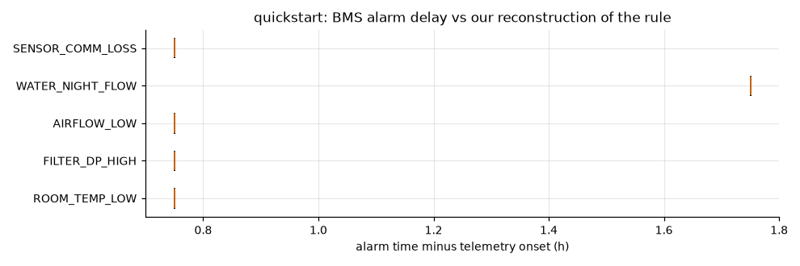

*quickstart: BMS alarm delay*

Unsupported alarms (first rows):

| code | asset | raised (UTC) | reported value | series at alarm |
|---|---|---|---|---|
| SENSOR_COMM_LOSS | R309 | 2026-01-14T22:45Z | - | 0.00 |

Alarms cleared while the reported value still meets the raise condition: 1.

Condition episodes of 1 h or longer and whether any alarm followed (alarms are incomplete if many are missed):

| code | episodes | without alarm |
|---|---|---|
| ROOM_TEMP_LOW | 60 | 28 |
| ROOM_TEMP_HIGH | 0 | 0 |
| FILTER_DP_HIGH | 3 | 0 |
| AIRFLOW_LOW | 5 | 3 |
| WATER_NIGHT_FLOW | 2 | 1 |
| SENSOR_COMM_LOSS | 20 | 0 |

### 4.2 `dev`

| source | rows | min (h) | p10 (h) | median (h) | max (h) | known late (<0) |
|---|---|---|---|---|---|---|
| tariff: hour start - published_utc | 8,760 | 11.0 | 13.0 | 22.5 | 35.0 | 0 |
| forecast: target_utc - issued_utc | 17,484 | 1.0 | 5.0 | 24.0 | 48.0 | 0 |
| roster scheduled: start - status_known | 1,703 | 336.0 | 336.0 | 336.0 | 336.0 | 0 |
| roster sick: start - status_known | 27 | 0.5 | 0.8 | 2.2 | 9.0 | 0 |
| roster vacation: start - status_known | 17 | 720.0 | 720.0 | 720.0 | 720.0 | 0 |
| roster out_of_service: start - status_known | 13 | -3.0 | -1.4 | 5.0 | 13.8 | 2 |
| booking: arrival - created_utc | 4,088 | -38.0 | 59.4 | 288.1 | 5,369 | 7 |
| work order: scheduled - created_utc | 76 | 0.2 | 1.8 | 6.0 | 168.0 | 0 |
| guest request: response_due - timestamp | 1,612 | 0.2 | 0.5 | 3.0 | 24.0 | 0 |

Roster changes (status other than scheduled), local shift start:

| shift | resource | status | shift start (local) | notice (h) |
|---|---|---|---|---|
| SH000067 | CLEANER_3 | sick | Wed 2026-01-14 07:00 | 7.5 |
| SH000074 | ROBOT_1 | out_of_service | Fri 2026-01-16 06:00 | 10.0 |
| SH000080 | ROBOT_2 | out_of_service | Sat 2026-01-17 06:00 | 2.0 |
| SH000149 | ROBOT_1 | out_of_service | Sun 2026-02-01 06:00 | 10.5 |
| SH000208 | CLEANER_1 | sick | Fri 2026-02-13 07:00 | 1.2 |
| SH000347 | CLEANER_2 | sick | Sat 2026-03-14 07:00 | 4.2 |
| SH000376 | TECH_1 | sick | Fri 2026-03-20 08:00 | 0.8 |
| SH000402 | CLEANER_1 | sick | Thu 2026-03-26 07:00 | 5.2 |
| SH000496 | CLEANER_1 | sick | Wed 2026-04-15 07:00 | 1.0 |
| SH000508 | CLEANER_2 | sick | Fri 2026-04-17 07:00 | 7.0 |
| SH000546 | CLEANER_2 | sick | Sat 2026-04-25 07:00 | 2.8 |
| SH000610 | ROBOT_1 | out_of_service | Sat 2026-05-09 06:00 | -3.0 |
| SH000613 | CLEANER_2 | sick | Sat 2026-05-09 07:00 | 0.5 |
| SH000622 | CLEANER_2 | sick | Mon 2026-05-11 07:00 | 1.8 |
| SH000756 | ROBOT_2 | out_of_service | Mon 2026-06-08 06:00 | 11.0 |
| SH000759 | TECH_1 | sick | Mon 2026-06-08 08:00 | 4.2 |
| SH000777 | CLEANER_1 | sick | Fri 2026-06-12 07:00 | 2.8 |
| SH000811 | CLEANER_2 | sick | Fri 2026-06-19 07:00 | 0.5 |
| SH000967 | TECH_1 | vacation | Tue 2026-07-21 08:00 | 720.0 |
| SH000973 | TECH_1 | vacation | Wed 2026-07-22 08:00 | 720.0 |
| SH000977 | CLEANER_2 | sick | Thu 2026-07-23 07:00 | 4.0 |
| SH000979 | TECH_1 | vacation | Thu 2026-07-23 08:00 | 720.0 |
| SH000984 | TECH_1 | vacation | Fri 2026-07-24 08:00 | 720.0 |
| SH000998 | TECH_1 | vacation | Mon 2026-07-27 08:00 | 720.0 |
| SH001003 | TECH_1 | vacation | Tue 2026-07-28 08:00 | 720.0 |
| SH001009 | TECH_1 | vacation | Wed 2026-07-29 08:00 | 720.0 |
| SH001015 | TECH_1 | vacation | Thu 2026-07-30 08:00 | 720.0 |
| SH001021 | TECH_1 | vacation | Fri 2026-07-31 08:00 | 720.0 |
| SH001026 | ROBOT_1 | out_of_service | Sun 2026-08-02 06:00 | 2.0 |
| SH001034 | TECH_1 | vacation | Mon 2026-08-03 08:00 | 720.0 |
| SH001131 | ROBOT_2 | out_of_service | Sun 2026-08-23 06:00 | 13.8 |
| SH001244 | CLEANER_2 | sick | Tue 2026-09-15 07:00 | 1.8 |
| SH001263 | ROBOT_1 | out_of_service | Sat 2026-09-19 06:00 | -2.2 |
| SH001266 | CLEANER_2 | sick | Sat 2026-09-19 07:00 | 0.8 |
| SH001276 | CLEANER_2 | sick | Mon 2026-09-21 07:00 | 0.8 |
| SH001292 | CLEANER_3 | sick | Thu 2026-09-24 07:00 | 1.5 |
| SH001304 | ROBOT_2 | out_of_service | Sun 2026-09-27 06:00 | 3.5 |
| SH001348 | CLEANER_3 | sick | Tue 2026-10-06 07:00 | 0.8 |
| SH001402 | ROBOT_1 | out_of_service | Sun 2026-10-18 06:00 | 5.0 |
| SH001410 | TECH_1 | vacation | Mon 2026-10-19 08:00 | 720.0 |
| SH001415 | TECH_1 | vacation | Tue 2026-10-20 08:00 | 720.0 |
| SH001421 | TECH_1 | vacation | Wed 2026-10-21 08:00 | 720.0 |
| SH001426 | TECH_1 | vacation | Thu 2026-10-22 08:00 | 720.0 |
| SH001431 | TECH_1 | vacation | Fri 2026-10-23 08:00 | 720.0 |
| SH001438 | CLEANER_1 | sick | Sun 2026-10-25 07:00 | 2.0 |
| SH001444 | TECH_1 | vacation | Mon 2026-10-26 08:00 | 720.0 |
| SH001449 | TECH_1 | vacation | Tue 2026-10-27 08:00 | 720.0 |
| SH001464 | TECH_1 | sick | Fri 2026-10-30 08:00 | 5.8 |
| SH001476 | CLEANER_3 | sick | Mon 2026-11-02 07:00 | 9.0 |
| SH001512 | ROBOT_2 | out_of_service | Tue 2026-11-10 06:00 | 12.2 |
| SH001558 | CLEANER_3 | sick | Thu 2026-11-19 07:00 | 2.5 |
| SH001567 | CLEANER_1 | sick | Sat 2026-11-21 07:00 | 8.5 |
| SH001571 | CLEANER_1 | sick | Sun 2026-11-22 07:00 | 1.2 |
| SH001603 | ROBOT_1 | out_of_service | Sun 2026-11-29 06:00 | 2.2 |
| SH001606 | CLEANER_2 | sick | Sun 2026-11-29 07:00 | 2.2 |
| SH001708 | ROBOT_1 | out_of_service | Mon 2026-12-21 06:00 | 11.2 |
| SH001758 | CLEANER_1 | sick | Thu 2026-12-31 07:00 | 3.0 |

`bookings.csv` has no cancellation timestamp: a `cancelled` booking does not say when the cancellation became known, so cancellations cannot be replayed faithfully (open question 2).

Forecast error by lead time (forecast minus measured outdoor temperature):

| lead (h) | pairs | MAE (degC) | bias (degC) |
|---|---|---|---|
| (0, 6] | 2,190 | 0.57 | 0.00 |
| (6, 12] | 2,190 | 0.97 | 0.02 |
| (12, 24] | 4,374 | 1.43 | 0.03 |
| (24, 36] | 4,368 | 2.03 | 0.03 |
| (36, 48] | 4,362 | 2.59 | 0.25 |

BMS alarms. Each raised alarm is matched to the onset of its condition in the preceding 24 h. Thresholds are our reconstruction from the raised values; *unsupported* means the condition never held in the window, i.e. the alarm looks false or refers to data we do not have.

| code | reconstructed rule | raised values | raised | median delay (h) | p90 delay (h) | max delay (h) | censored at window | unsupported |
|---|---|---|---|---|---|---|---|---|
| ROOM_TEMP_LOW | room_temperature < 17.5 degC | 16.96..17.49 | 160 | 0.75 | 0.75 | 1.00 | 0 | 0 |
| ROOM_TEMP_HIGH | room_temperature > 28.0 degC | 28.02..28.89 | 125 | 1.75 | 1.75 | 1.75 | 0 | 0 |
| FILTER_DP_HIGH | AHU1/filter_dp_pa > 250.0 Pa | 260.30..293.30 | 10 | 2.12 | 24.00 | 24.00 | 2 | 0 |
| AIRFLOW_LOW | AHU1/airflow_day_m3h < 3,500 m3/h | 3,011..3,480 | 9 | 24.00 | 24.00 | 24.00 | 5 | 0 |
| WATER_NIGHT_FLOW | main_night_delta > 25.0 L/15min | 28.10..28.10 | 1 | 1.75 | 1.75 | 1.75 | 0 | 0 |
| SENSOR_COMM_LOSS | room_row_missing > 0.5 flag | - | 159 | 0.75 | 0.75 | 0.75 | 0 | 19 |

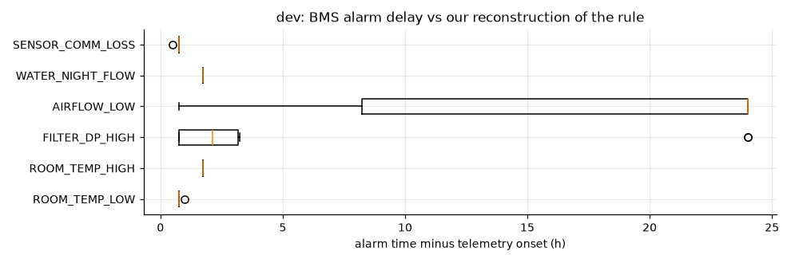

*dev: BMS alarm delay*

Unsupported alarms (first rows):

| code | asset | raised (UTC) | reported value | series at alarm |
|---|---|---|---|---|
| SENSOR_COMM_LOSS | R205 | 2026-01-04T18:15Z | - | 0.00 |
| SENSOR_COMM_LOSS | R201 | 2026-02-10T16:30Z | - | 0.00 |
| SENSOR_COMM_LOSS | R304 | 2026-02-24T18:30Z | - | 0.00 |
| SENSOR_COMM_LOSS | R208 | 2026-03-08T01:30Z | - | 0.00 |
| SENSOR_COMM_LOSS | R406 | 2026-03-20T11:45Z | - | 0.00 |
| SENSOR_COMM_LOSS | R410 | 2026-05-09T01:00Z | - | 0.00 |
| SENSOR_COMM_LOSS | R308 | 2026-05-17T21:30Z | - | 0.00 |
| SENSOR_COMM_LOSS | R107 | 2026-05-20T12:45Z | - | 0.00 |
| SENSOR_COMM_LOSS | R204 | 2026-06-14T13:45Z | - | 0.00 |
| SENSOR_COMM_LOSS | R210 | 2026-07-05T13:45Z | - | 0.00 |

Alarms cleared while the reported value still meets the raise condition: 8.

Condition episodes of 1 h or longer and whether any alarm followed (alarms are incomplete if many are missed):

| code | episodes | without alarm |
|---|---|---|
| ROOM_TEMP_LOW | 1,077 | 914 |
| ROOM_TEMP_HIGH | 250 | 107 |
| FILTER_DP_HIGH | 10 | 0 |
| AIRFLOW_LOW | 16 | 6 |
| WATER_NIGHT_FLOW | 3 | 2 |
| SENSOR_COMM_LOSS | 140 | 0 |

## 5. Scenario signals (exploratory)

Every episode below is a *candidate* from a transparent screening rule (`src/plato40/audit/candidates.py`), run on the whole dataset with hindsight. These are not detections and the screens are not detectors: a detector must use only information known at decision time. Work orders written after the fact are used here only to judge whether a candidate is plausible (last subsection).

### 5.1 `quickstart`

#### S01 Turnaround

Hypothesis: guests wait for a room on days when check-outs are many, a cleaner is absent, or an early check-in was requested for a room whose previous guest left late; robots finishing a floor does not make a room ready.

Screen: every `arrival_waiting_room` event. 8 candidates on 3 local days; 2 of those days had a cleaner absent.

| kind | assets | start (UTC) | end (UTC) | signal |
|---|---|---|---|---|
| guest_waited_for_room | R308 | 2026-01-08T10:30Z | 2026-01-08T11:15Z | waited 0.75 h; early check-in requested; previous checkout 09:45Z; cleaning completed 11:00Z |
| guest_waited_for_room | R207 | 2026-01-23T11:15Z | 2026-01-23T11:45Z | waited 0.50 h; early check-in requested; previous checkout 08:30Z; cleaning completed 11:30Z |
| guest_waited_for_room | R403 | 2026-01-24T11:15Z | 2026-01-24T11:30Z | waited 0.25 h; early check-in requested; previous checkout 07:45Z; cleaning completed 11:15Z |
| guest_waited_for_room | R302 | 2026-01-24T12:00Z | 2026-01-24T13:30Z | waited 1.50 h; no request; previous checkout 11:45Z; cleaning completed 13:15Z |
| guest_waited_for_room | R108 | 2026-01-24T13:00Z | 2026-01-24T14:15Z | waited 1.25 h; no request; previous checkout 08:45Z; cleaning completed 14:00Z |
| guest_waited_for_room | R304 | 2026-01-24T13:30Z | 2026-01-24T15:00Z | waited 1.50 h; no request; previous checkout 08:45Z; cleaning completed 14:45Z |
| guest_waited_for_room | R101 | 2026-01-24T15:00Z | 2026-01-24T17:15Z | waited 2.25 h; no request; previous checkout 09:30Z; cleaning completed 17:00Z |
| guest_waited_for_room | R306 | 2026-01-24T15:15Z | 2026-01-24T18:45Z | waited 3.50 h; no request; previous checkout 09:30Z; cleaning completed 18:30Z |

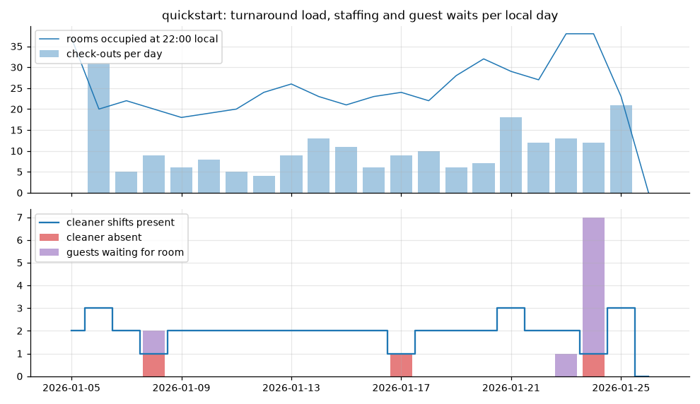

*quickstart: S01 operations per day*

Benign look-alikes seen:

- `checkin_early` without any wait: 37 events. An early arrival is not a conflict when the room was ready.
- Human room cleanings preceded by a robot floor cleaning of the same room within 6 h: 170 of 215. A robot `completed` event is not readiness; only the human `cleaning_completed` (and inspection when required) is.
- Room door access by the booking credential after check-out is not logged as a return; exits are not logged at all, so presence must come from motion, not doors.

#### S02 Hidden water leak

Hypothesis: a leak shows as flow that never stops at night in one room meter (running toilet: small and steady; burst hose: large), or as a night-time gap between the main meter and the sum of room meters (leak outside the rooms). Guests, cleaning and meter artefacts produce short spikes, daytime use or steps, not a steady night floor.

Screens: room night floor >= 0.5 L per 15 min in every night interval (01:00-05:00 local) for >= 2 nights; room night volume >= 300 L; median night gap >= 10.0 L/h. 2 candidates.

| kind | assets | start (UTC) | end (UTC) | signal |
|---|---|---|---|---|
| loud_room_night_volume | R104 | 2026-01-12T23:00Z | 2026-01-13T23:00Z | 436 L in the night window |
| persistent_room_night_flow | R305 | 2026-01-19T23:00Z | 2026-01-25T23:00Z | 6 nights with flow in every night interval, median floor 4.0 L/h |

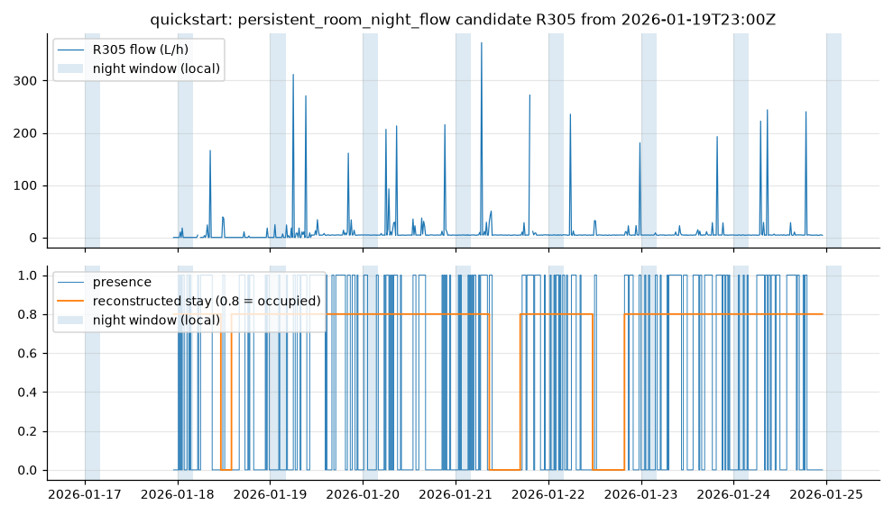

*quickstart: S02 candidate signals*

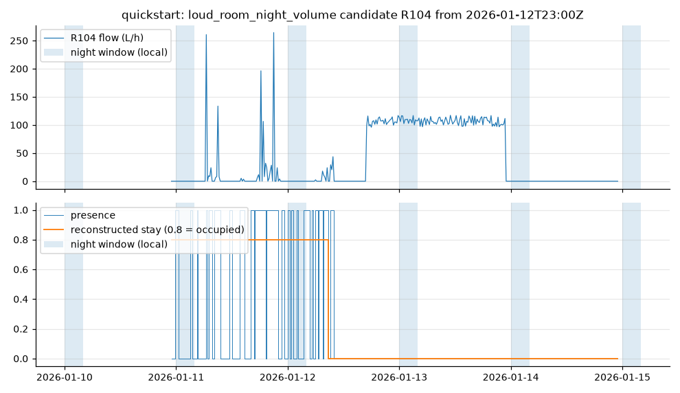

*quickstart: S02 candidate signals*

Benign look-alikes seen:

- Night use that is not continuous (room night volume >= 20 L but some night interval below the floor threshold): 49 room-nights. These are showers, baths and toilet flushes; they fail the persistence test.
- Legionella flushing work orders: 1. Flushing draws water in long-vacant rooms by design; vacant-room flow on those days is expected.
- Cleaning starts between 7:00 and 15:00 local: cleaning water is daytime and outside the night window.
- Daily main-minus-rooms gap alternates by day parity: median 290 L on even and 275 L on odd ordinal days. An every-other-day common-area draw (consistent with roof-garden irrigation) raises the daily gap without any leak; the night gap is the cleaner signal.
- Meter artefacts: resets at exchange and post-exchange jitter (section 2) create negative and positive steps that must not read as flow.
- `WATER_NIGHT_FLOW` BMS alarms: 1 raise/clear pairs, on the main meter only; they cannot localise a room leak and miss small steady leaks.

#### S03 Energy versus comfort

Hypothesis: a degraded heat pump shows as daily COP well below what the outdoor temperature predicts; when it meets a cold spell, occupied rooms fall below the comfort band and below their setpoint. Price peaks matter for when to pre-heat, not whether to protect occupants.

Screens: daily COP < 0.85 x fit; >= 10 occupied comfort-deficit room-h per day. 3 candidates.

| kind | assets | start (UTC) | end (UTC) | signal |
|---|---|---|---|---|
| occupied_comfort_deficit | BUILDING | 2026-01-12T23:00Z | 2026-01-13T23:00Z | 1 d, 14 occupied room-h below 20 degC and >= 1.5 K under setpoint |
| occupied_comfort_deficit | BUILDING | 2026-01-14T23:00Z | 2026-01-18T23:00Z | 4 d, 386 occupied room-h below 20 degC and >= 1.5 K under setpoint |
| occupied_comfort_deficit | BUILDING | 2026-01-22T23:00Z | 2026-01-23T23:00Z | 1 d, 13 occupied room-h below 20 degC and >= 1.5 K under setpoint |

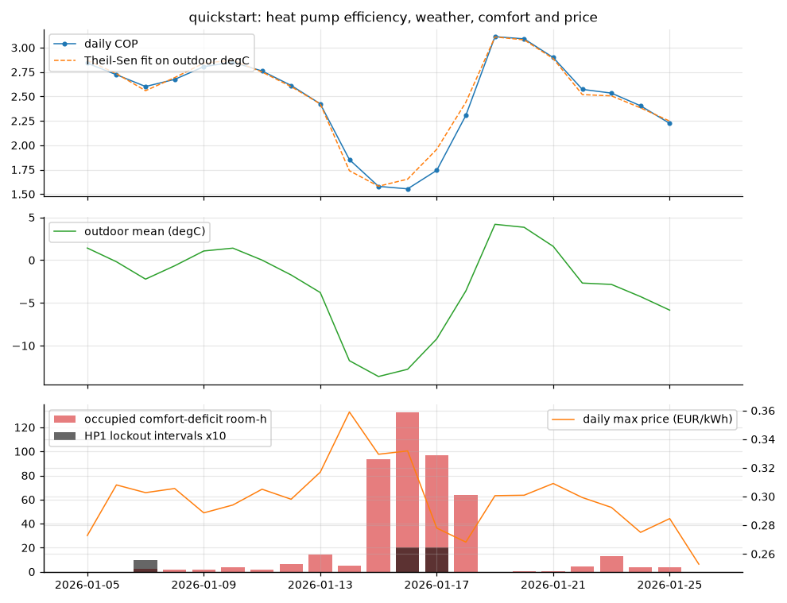

*quickstart: S03 signals*

HP1 lockout intervals: 5; guest `temperature_cold` requests: 23. Occupied comfort-deficit room-hours by floor: F1 310 h, F2 47 h, F3 38 h, F4 55 h.

Benign look-alikes seen:

- Vacant rooms below 20 degC: 7,799 room-h. This is the 18 degC setback, not a fault.
- Occupied rooms below the band with the window open: 30 room-h. Cause is the window, not the plant.
- Guests who set 19.5 or 20 degC: below-band temperature at the guest's own setpoint is a choice; the deficit screen requires a 1.5 K shortfall to the setpoint.
- A frozen temperature sensor reads a constant value below the band (section 2) and looks like a cold room.
- Cold days alone lower COP. When a cold spell and a degradation coincide in a short window, a COP fit on that window absorbs part of the degradation, so daily COP alone under-reports it.

#### S04 Maintenance cascade

Hypothesis: filter loading raises AHU1 filter dp and fan power and lowers airflow over days; a dp sensor gap can hide the crossing, but fan power keeps reporting; the technician being absent or a postponed filter change turns it into a cascade.

2 candidates.

| kind | assets | start (UTC) | end (UTC) | signal |
|---|---|---|---|---|
| filter_dp_data_gap | AHU1 | 2026-01-16T22:30Z | 2026-01-21T03:15Z | dp missing 101 h; dp 106->147 Pa across the gap, fan 24 h mean 3.23->5.40 kW |
| filter_dp_high | AHU1 | 2026-01-20T23:00Z | 2026-01-23T23:00Z | 3 d, daily max dp up to 288 Pa (0 d without dp), fan 5.40 kW daily mean |

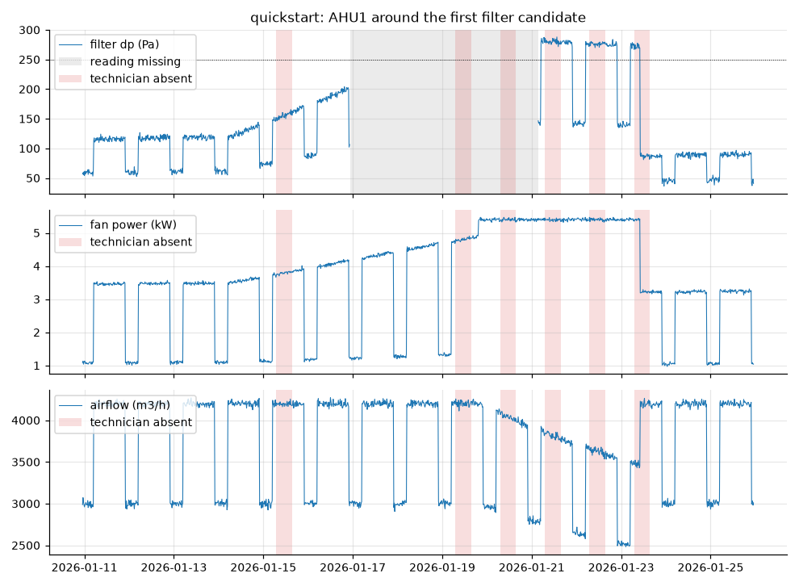

*quickstart: S04 AHU1 signals*

Technician absences: 6 shifts; postponed work orders: 0.

Benign look-alikes seen:

- Daily dp cycle: the night median dp is 0.52 times the midday median, so dp alarms clear at night without any repair (see section 4, alarms cleared while active).
- A dp data gap is not degradation and not recovery; fan power continuing to rise across the gap is the second signal that separates the two.
- AHU1 night setback: median fan 1.09 kW and airflow 3,001 m3/h while fan < 2.0 kW. Low airflow is a fault signal only in day mode.
- Fan power has a ceiling (maximum observed 5.47 kW). Once it is reached, further filter loading lowers airflow instead of raising fan power, so the second signal changes channel.

#### S05 Unexpected weekend

Hypothesis: an event weekend shows as near-full occupancy Friday to Sunday with many same-day turnarounds, and a cleaner absence in the same window cuts capacity below demand.

Screen: Fri-Sun with peak occupancy >= 90 % of 40 rooms, or any cleaner absence on those days. 2 candidates.

| kind | assets | start (UTC) | end (UTC) | signal |
|---|---|---|---|---|
| absence_on_weekend | BUILDING | 2026-01-15T23:00Z | 2026-01-18T23:00Z | weekend of 2026-01-16: peak 24/40 rooms occupied at 22:00, 25 check-outs, 1 cleaner shift(s) absent |
| surge_and_absence | BUILDING | 2026-01-22T23:00Z | 2026-01-25T23:00Z | weekend of 2026-01-23: peak 38/40 rooms occupied at 22:00, 46 check-outs, 1 cleaner shift(s) absent |

Normal weekends for comparison: Friday and Saturday nights have median 24 occupied rooms (max 38). Benign look-alikes: a full weekend with all cleaners present, and a weekday absence; neither is S05 on its own. The on-call housekeeper has no roster rows, so on-call capacity can only be inferred from `oncall_housekeeping_called` events (2 here).

#### Logistics

Hypothesis: the central container fills between the Tuesday and Friday pickups and reaches its cap after busy weekends; vending drinks run out before the Monday/Thursday restock in high season.

0 candidates (fill at the 100 % cap, `waste_bin_full`, `vending_out_of_stock`). Peak WASTE_MAIN fill 76.2 %.

No candidates.

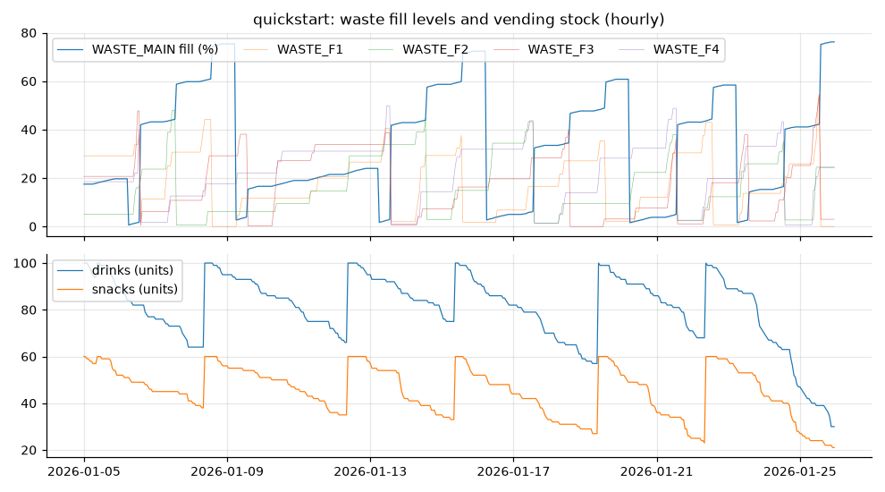

*quickstart: logistics*

Benign look-alike: a value of 100 % is a cap, so the time at 100 % understates overflow, and a low weekend fill when the hotel is empty is not a sensor fault.

### 5.2 `dev`

#### S01 Turnaround

Hypothesis: guests wait for a room on days when check-outs are many, a cleaner is absent, or an early check-in was requested for a room whose previous guest left late; robots finishing a floor does not make a room ready.

Screen: every `arrival_waiting_room` event. 24 candidates on 16 local days; 7 of those days had a cleaner absent.

| kind | assets | start (UTC) | end (UTC) | signal |
|---|---|---|---|---|
| guest_waited_for_room | R202 | 2026-01-02T12:45Z | 2026-01-02T13:15Z | waited 0.50 h; early check-in requested; previous checkout 08:30Z; cleaning completed 13:00Z |
| guest_waited_for_room | R202 | 2026-02-13T10:30Z | 2026-02-13T11:30Z | waited 1.00 h; early check-in requested; previous checkout 09:30Z; cleaning completed 11:15Z |
| guest_waited_for_room | R305 | 2026-02-28T10:15Z | 2026-02-28T11:00Z | waited 0.75 h; early check-in requested; previous checkout 09:45Z; cleaning completed 10:45Z |
| guest_waited_for_room | R202 | 2026-04-15T09:15Z | 2026-04-15T10:00Z | waited 0.75 h; early check-in requested; previous checkout 08:45Z; cleaning completed 09:45Z |
| guest_waited_for_room | R410 | 2026-05-09T10:45Z | 2026-05-09T12:30Z | waited 1.75 h; early check-in requested; previous checkout 08:00Z; cleaning completed 12:15Z |
| guest_waited_for_room | R209 | 2026-05-09T11:30Z | 2026-05-09T13:00Z | waited 1.50 h; early check-in requested; previous checkout 08:45Z; cleaning completed 12:45Z |
| guest_waited_for_room | R207 | 2026-05-09T11:30Z | 2026-05-09T12:45Z | waited 1.25 h; no request; previous checkout 08:30Z; cleaning completed 12:30Z |
| guest_waited_for_room | R204 | 2026-05-09T12:00Z | 2026-05-09T13:45Z | waited 1.75 h; no request; previous checkout 08:45Z; cleaning completed 13:30Z |
| guest_waited_for_room | R303 | 2026-05-11T09:30Z | 2026-05-11T10:00Z | waited 0.50 h; no request; previous checkout 06:15Z; cleaning completed 09:45Z |
| guest_waited_for_room | R409 | 2026-05-11T20:30Z | 2026-05-12T09:00Z | waited 12.50 h; no request; previous checkout 10:00Z; cleaning completed 05:30Z |
| guest_waited_for_room | R110 | 2026-05-18T09:45Z | 2026-05-18T10:15Z | waited 0.50 h; early check-in requested; previous checkout 08:45Z; cleaning completed 10:00Z |
| guest_waited_for_room | R310 | 2026-05-19T10:00Z | 2026-05-19T10:30Z | waited 0.50 h; no request; previous checkout 08:45Z; cleaning completed 10:15Z |
| guest_waited_for_room | R401 | 2026-06-19T09:00Z | 2026-06-19T09:30Z | waited 0.50 h; early check-in requested; previous checkout 08:30Z; cleaning completed 09:15Z |
| guest_waited_for_room | R108 | 2026-07-12T10:00Z | 2026-07-12T10:15Z | waited 0.25 h; early check-in requested; previous checkout 08:45Z; cleaning completed 10:00Z |
| guest_waited_for_room | R310 | 2026-07-20T09:00Z | 2026-07-20T10:30Z | waited 1.50 h; early check-in requested; previous checkout 08:15Z; cleaning completed 10:15Z |
| guest_waited_for_room | R401 | 2026-09-09T09:00Z | 2026-09-09T09:45Z | waited 0.75 h; no request; previous checkout 07:45Z; cleaning completed 09:30Z |
| guest_waited_for_room | R207 | 2026-09-18T10:00Z | 2026-09-18T10:15Z | waited 0.25 h; early check-in requested; previous checkout 08:45Z; cleaning completed 10:00Z |
| guest_waited_for_room | R305 | 2026-09-19T10:45Z | 2026-09-19T12:15Z | waited 1.50 h; early check-in requested; previous checkout 08:15Z; cleaning completed 12:00Z |
| guest_waited_for_room | R203 | 2026-09-19T11:00Z | 2026-09-19T11:15Z | waited 0.25 h; early check-in requested; previous checkout 07:30Z; cleaning completed 11:00Z |
| guest_waited_for_room | R301 | 2026-09-19T11:00Z | 2026-09-19T12:00Z | waited 1.00 h; no request; previous checkout 07:45Z; cleaning completed 11:45Z |
| guest_waited_for_room | R409 | 2026-09-19T11:30Z | 2026-09-19T13:00Z | waited 1.50 h; early check-in requested; previous checkout 08:15Z; cleaning completed 12:45Z |
| guest_waited_for_room | R208 | 2026-09-19T13:45Z | 2026-09-19T14:15Z | waited 0.50 h; no request; previous checkout 08:45Z; cleaning completed 14:00Z |
| guest_waited_for_room | R302 | 2026-09-21T09:15Z | 2026-09-21T10:45Z | waited 1.50 h; early check-in requested; previous checkout 08:30Z; cleaning completed 10:30Z |
| guest_waited_for_room | R310 | 2026-11-28T11:15Z | 2026-11-28T11:30Z | waited 0.25 h; early check-in requested; previous checkout 09:45Z; cleaning completed 11:15Z |

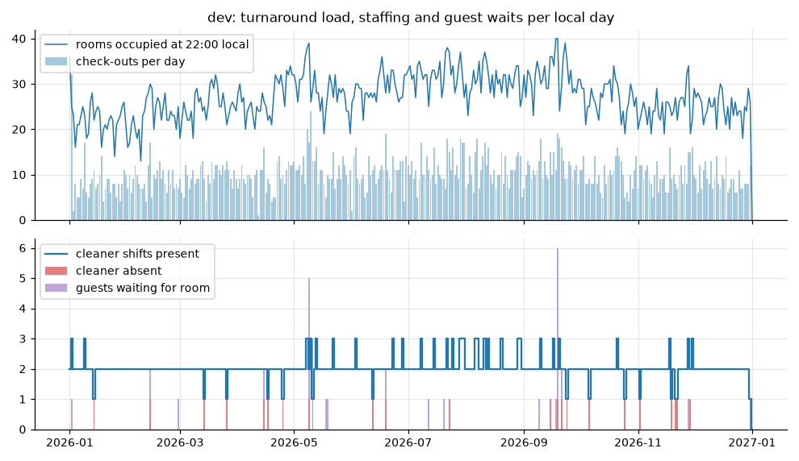

*dev: S01 operations per day*

Benign look-alikes seen:

- `checkin_early` without any wait: 425 events. An early arrival is not a conflict when the room was ready.
- Human room cleanings preceded by a robot floor cleaning of the same room within 6 h: 3093 of 3714. A robot `completed` event is not readiness; only the human `cleaning_completed` (and inspection when required) is.
- Room door access by the booking credential after check-out is not logged as a return; exits are not logged at all, so presence must come from motion, not doors.

#### S02 Hidden water leak

Hypothesis: a leak shows as flow that never stops at night in one room meter (running toilet: small and steady; burst hose: large), or as a night-time gap between the main meter and the sum of room meters (leak outside the rooms). Guests, cleaning and meter artefacts produce short spikes, daytime use or steps, not a steady night floor.

Screens: room night floor >= 0.5 L per 15 min in every night interval (01:00-05:00 local) for >= 2 nights; room night volume >= 300 L; median night gap >= 10.0 L/h. 5 candidates.

| kind | assets | start (UTC) | end (UTC) | signal |
|---|---|---|---|---|
| loud_room_night_volume | R201 | 2026-03-19T23:00Z | 2026-03-20T23:00Z | 442 L in the night window |
| persistent_room_night_flow | R403 | 2026-06-20T22:00Z | 2026-06-28T22:00Z | 8 nights with flow in every night interval, median floor 3.6 L/h |
| night_gap_main_minus_rooms | WM_MAIN | 2026-07-10T22:00Z | 2026-07-18T22:00Z | 8 nights, median night gap 28.5 L/h |
| loud_room_night_volume | R401 | 2026-08-16T22:00Z | 2026-08-17T22:00Z | 313 L in the night window |
| persistent_room_night_flow | R208 | 2026-11-10T23:00Z | 2026-11-17T23:00Z | 7 nights with flow in every night interval, median floor 3.6 L/h |

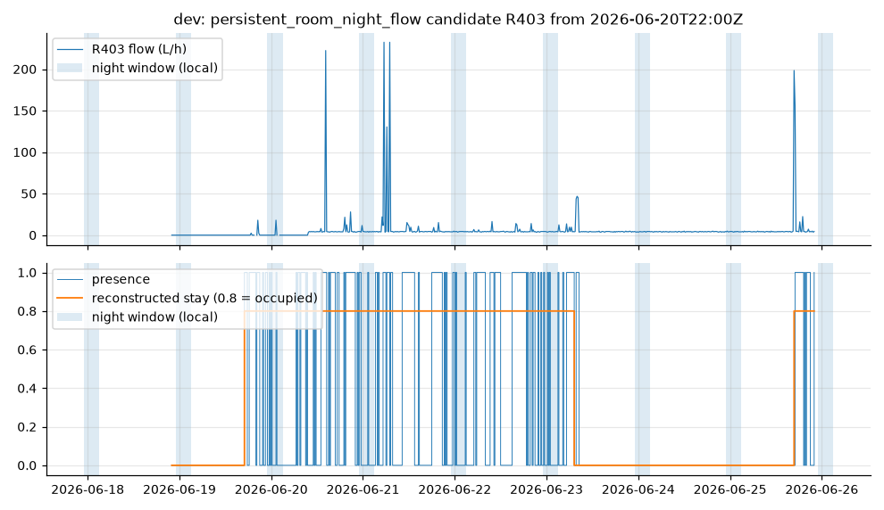

*dev: S02 candidate signals*

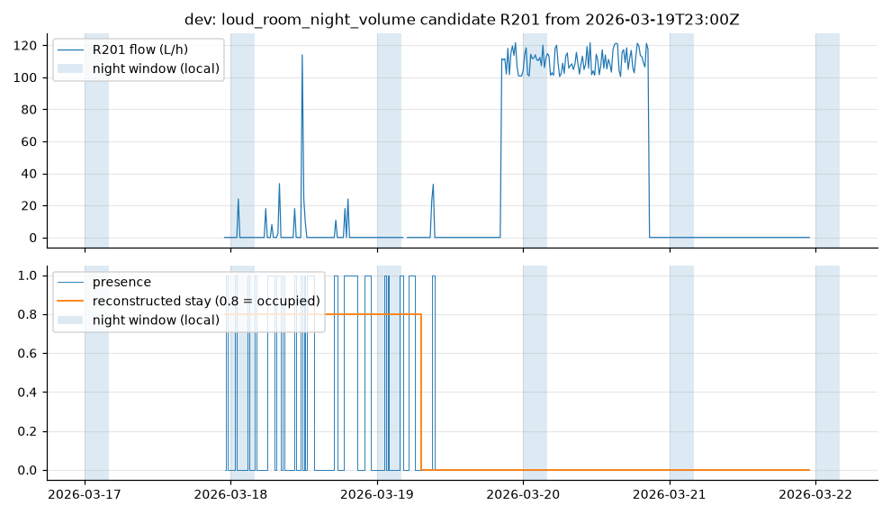

*dev: S02 candidate signals*

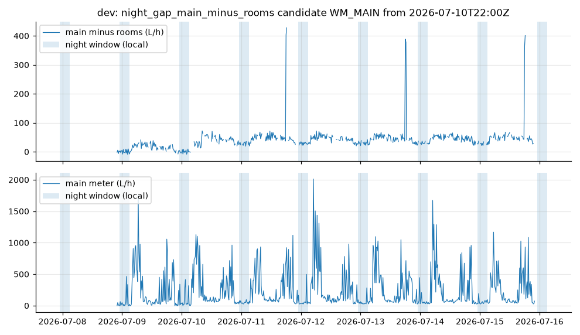

*dev: S02 candidate signals*

Benign look-alikes seen:

- Night use that is not continuous (room night volume >= 20 L but some night interval below the floor threshold): 857 room-nights. These are showers, baths and toilet flushes; they fail the persistence test.
- Legionella flushing work orders: 11. Flushing draws water in long-vacant rooms by design; vacant-room flow on those days is expected.
- Cleaning starts between 7:00 and 15:00 local: cleaning water is daytime and outside the night window.
- Daily main-minus-rooms gap alternates by day parity: median 307 L on even and 289 L on odd ordinal days. An every-other-day common-area draw (consistent with roof-garden irrigation) raises the daily gap without any leak; the night gap is the cleaner signal.
- Meter artefacts: resets at exchange and post-exchange jitter (section 2) create negative and positive steps that must not read as flow.
- `WATER_NIGHT_FLOW` BMS alarms: 1 raise/clear pairs, on the main meter only; they cannot localise a room leak and miss small steady leaks.

#### S03 Energy versus comfort

Hypothesis: a degraded heat pump shows as daily COP well below what the outdoor temperature predicts; when it meets a cold spell, occupied rooms fall below the comfort band and below their setpoint. Price peaks matter for when to pre-heat, not whether to protect occupants.

Screens: daily COP < 0.85 x fit; >= 10 occupied comfort-deficit room-h per day. 15 candidates.

| kind | assets | start (UTC) | end (UTC) | signal |
|---|---|---|---|---|
| cop_below_outdoor_fit | HP1 | 2026-01-24T23:00Z | 2026-01-26T23:00Z | 2 d, COP 1.85..2.02, ratio to fit 0.81, outdoor -7.2..-4.6 degC |
| occupied_comfort_deficit | BUILDING | 2026-01-24T23:00Z | 2026-01-25T23:00Z | 1 d, 15 occupied room-h below 20 degC and >= 1.5 K under setpoint |
| occupied_comfort_deficit | BUILDING | 2026-05-01T22:00Z | 2026-05-08T22:00Z | 7 d, 352 occupied room-h below 20 degC and >= 1.5 K under setpoint |
| occupied_comfort_deficit | BUILDING | 2026-05-14T22:00Z | 2026-05-17T22:00Z | 3 d, 67 occupied room-h below 20 degC and >= 1.5 K under setpoint |
| occupied_comfort_deficit | BUILDING | 2026-06-06T22:00Z | 2026-06-07T22:00Z | 1 d, 14 occupied room-h below 20 degC and >= 1.5 K under setpoint |
| occupied_comfort_deficit | BUILDING | 2026-07-31T22:00Z | 2026-08-06T22:00Z | 6 d, 169 occupied room-h below 20 degC and >= 1.5 K under setpoint |
| occupied_comfort_deficit | BUILDING | 2026-08-20T22:00Z | 2026-08-24T22:00Z | 4 d, 186 occupied room-h below 20 degC and >= 1.5 K under setpoint |
| occupied_comfort_deficit | BUILDING | 2026-08-28T22:00Z | 2026-08-30T22:00Z | 2 d, 232 occupied room-h below 20 degC and >= 1.5 K under setpoint |
| occupied_comfort_deficit | BUILDING | 2026-08-31T22:00Z | 2026-09-05T22:00Z | 5 d, 179 occupied room-h below 20 degC and >= 1.5 K under setpoint |
| occupied_comfort_deficit | BUILDING | 2026-09-07T22:00Z | 2026-09-09T22:00Z | 2 d, 46 occupied room-h below 20 degC and >= 1.5 K under setpoint |
| occupied_comfort_deficit | BUILDING | 2026-09-11T22:00Z | 2026-09-15T22:00Z | 4 d, 135 occupied room-h below 20 degC and >= 1.5 K under setpoint |
| occupied_comfort_deficit | BUILDING | 2026-10-30T23:00Z | 2026-11-03T23:00Z | 4 d, 130 occupied room-h below 20 degC and >= 1.5 K under setpoint |
| occupied_comfort_deficit | BUILDING | 2026-11-26T23:00Z | 2026-11-28T23:00Z | 2 d, 24 occupied room-h below 20 degC and >= 1.5 K under setpoint |
| cop_below_outdoor_fit | HP1 | 2026-12-05T23:00Z | 2026-12-07T23:00Z | 2 d, COP 2.02..2.06, ratio to fit 0.82, outdoor -4.9..-4.5 degC |
| occupied_comfort_deficit | BUILDING | 2026-12-05T23:00Z | 2026-12-06T23:00Z | 1 d, 24 occupied room-h below 20 degC and >= 1.5 K under setpoint |

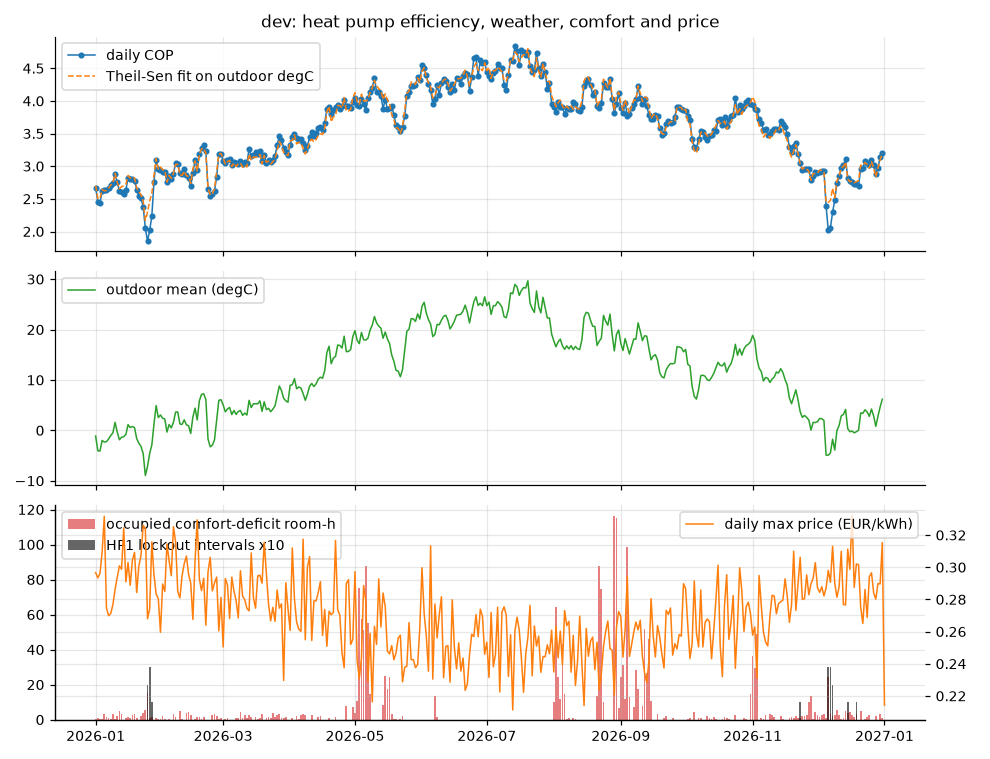

*dev: S03 signals*

HP1 lockout intervals: 17; guest `temperature_cold` requests: 29. Occupied comfort-deficit room-hours by floor: F1 1,034 h, F2 360 h, F3 233 h, F4 282 h.

Benign look-alikes seen:

- Vacant rooms below 20 degC: 86,574 room-h. This is the 18 degC setback, not a fault.
- Occupied rooms below the band with the window open: 996 room-h. Cause is the window, not the plant.
- Guests who set 19.5 or 20 degC: below-band temperature at the guest's own setpoint is a choice; the deficit screen requires a 1.5 K shortfall to the setpoint.
- A frozen temperature sensor reads a constant value below the band (section 2) and looks like a cold room.
- Cold days alone lower COP. When a cold spell and a degradation coincide in a short window, a COP fit on that window absorbs part of the degradation, so daily COP alone under-reports it.

#### S04 Maintenance cascade

Hypothesis: filter loading raises AHU1 filter dp and fan power and lowers airflow over days; a dp sensor gap can hide the crossing, but fan power keeps reporting; the technician being absent or a postponed filter change turns it into a cascade.

4 candidates.

| kind | assets | start (UTC) | end (UTC) | signal |
|---|---|---|---|---|
| filter_dp_high | AHU1 | 2026-07-20T22:00Z | 2026-07-29T22:00Z | 9 d, daily max dp up to 281 Pa (3 d without dp), fan 5.41 kW daily mean |
| filter_dp_data_gap | AHU1 | 2026-07-21T06:15Z | 2026-07-25T18:00Z | dp missing 108 h; dp 244->276 Pa across the gap, fan 24 h mean 3.50->5.40 kW |
| filter_dp_high | AHU1 | 2026-10-14T22:00Z | 2026-10-24T22:00Z | 10 d, daily max dp up to 297 Pa (4 d without dp), fan 5.41 kW daily mean |
| filter_dp_data_gap | AHU1 | 2026-10-17T21:15Z | 2026-10-22T09:00Z | dp missing 108 h; dp 143->267 Pa across the gap, fan 24 h mean 4.28->5.41 kW |

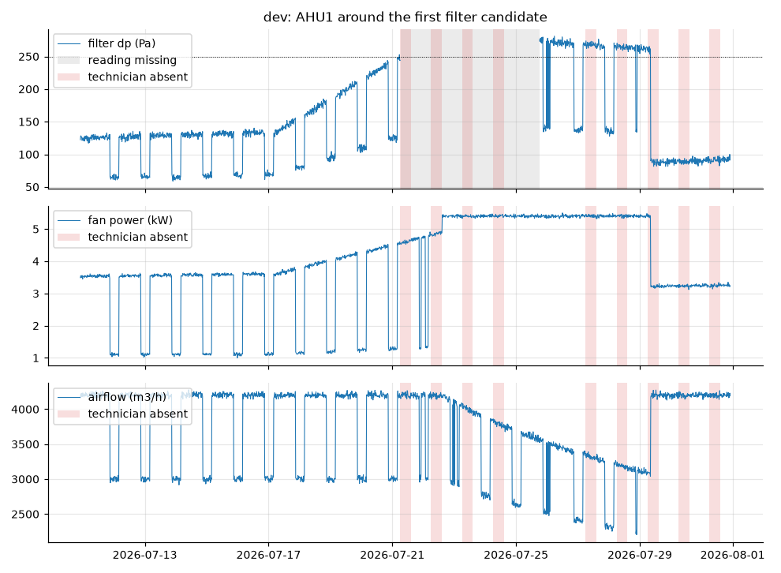

*dev: S04 AHU1 signals*

Technician absences: 20 shifts; postponed work orders: 2 (2026-02-23T08:00Z AHU1 filter change postponed - rooftop unit only reachable with lift platform, not available; 2026-06-04T07:00Z AHU1 filter change postponed - rooftop unit only reachable with lift platform, not available).

Benign look-alikes seen:

- Daily dp cycle: the night median dp is 0.55 times the midday median, so dp alarms clear at night without any repair (see section 4, alarms cleared while active).
- A dp data gap is not degradation and not recovery; fan power continuing to rise across the gap is the second signal that separates the two.
- AHU1 night setback: median fan 1.13 kW and airflow 3,000 m3/h while fan < 2.0 kW. Low airflow is a fault signal only in day mode.
- Fan power has a ceiling (maximum observed 5.51 kW). Once it is reached, further filter loading lowers airflow instead of raising fan power, so the second signal changes channel.

#### S05 Unexpected weekend

Hypothesis: an event weekend shows as near-full occupancy Friday to Sunday with many same-day turnarounds, and a cleaner absence in the same window cuts capacity below demand.

Screen: Fri-Sun with peak occupancy >= 90 % of 40 rooms, or any cleaner absence on those days. 11 candidates.

| kind | assets | start (UTC) | end (UTC) | signal |
|---|---|---|---|---|
| absence_on_weekend | BUILDING | 2026-02-12T23:00Z | 2026-02-15T23:00Z | weekend of 2026-02-13: peak 30/40 rooms occupied at 22:00, 32 check-outs, 1 cleaner shift(s) absent |
| absence_on_weekend | BUILDING | 2026-03-12T23:00Z | 2026-03-15T23:00Z | weekend of 2026-03-13: peak 25/40 rooms occupied at 22:00, 26 check-outs, 1 cleaner shift(s) absent |
| absence_on_weekend | BUILDING | 2026-04-16T22:00Z | 2026-04-19T22:00Z | weekend of 2026-04-17: peak 23/40 rooms occupied at 22:00, 21 check-outs, 1 cleaner shift(s) absent |
| absence_on_weekend | BUILDING | 2026-04-23T22:00Z | 2026-04-26T22:00Z | weekend of 2026-04-24: peak 32/40 rooms occupied at 22:00, 27 check-outs, 1 cleaner shift(s) absent |
| surge_and_absence | BUILDING | 2026-05-07T22:00Z | 2026-05-10T22:00Z | weekend of 2026-05-08: peak 39/40 rooms occupied at 22:00, 61 check-outs, 1 cleaner shift(s) absent |
| absence_on_weekend | BUILDING | 2026-06-11T22:00Z | 2026-06-14T22:00Z | weekend of 2026-06-12: peak 28/40 rooms occupied at 22:00, 31 check-outs, 1 cleaner shift(s) absent |
| absence_on_weekend | BUILDING | 2026-06-18T22:00Z | 2026-06-21T22:00Z | weekend of 2026-06-19: peak 32/40 rooms occupied at 22:00, 39 check-outs, 1 cleaner shift(s) absent |
| surge_and_absence | BUILDING | 2026-09-17T22:00Z | 2026-09-20T22:00Z | weekend of 2026-09-18: peak 40/40 rooms occupied at 22:00, 48 check-outs, 1 cleaner shift(s) absent |
| absence_on_weekend | BUILDING | 2026-10-22T22:00Z | 2026-10-25T22:00Z | weekend of 2026-10-23: peak 24/40 rooms occupied at 22:00, 28 check-outs, 1 cleaner shift(s) absent |
| absence_on_weekend | BUILDING | 2026-11-19T23:00Z | 2026-11-22T23:00Z | weekend of 2026-11-20: peak 27/40 rooms occupied at 22:00, 25 check-outs, 2 cleaner shift(s) absent |
| absence_on_weekend | BUILDING | 2026-11-26T23:00Z | 2026-11-29T23:00Z | weekend of 2026-11-27: peak 34/40 rooms occupied at 22:00, 38 check-outs, 1 cleaner shift(s) absent |

Normal weekends for comparison: Friday and Saturday nights have median 27 occupied rooms (max 40). Benign look-alikes: a full weekend with all cleaners present, and a weekday absence; neither is S05 on its own. The on-call housekeeper has no roster rows, so on-call capacity can only be inferred from `oncall_housekeeping_called` events (0 here).

#### Logistics

Hypothesis: the central container fills between the Tuesday and Friday pickups and reaches its cap after busy weekends; vending drinks run out before the Monday/Thursday restock in high season.

26 candidates (fill at the 100 % cap, `waste_bin_full`, `vending_out_of_stock`). Peak WASTE_MAIN fill 100.0 %.

26 candidates

| kind | assets | start (UTC) | end (UTC) | signal |
|---|---|---|---|---|
| vending_out_of_stock | VEND1 | 2026-04-26T21:45Z | 2026-04-26T21:45Z | vending_out_of_stock (drinks) |
| waste_bin_full | WASTE_MAIN | 2026-05-04T12:30Z | 2026-05-04T12:30Z | waste_bin_full |
| fill_at_cap | WASTE_MAIN | 2026-05-04T13:00Z | 2026-05-05T04:00Z | WASTE_MAIN/fill_pct at 100 % for 16 h (capped value, may overflow) |
| vending_out_of_stock | VEND1 | 2026-05-10T03:45Z | 2026-05-10T03:45Z | vending_out_of_stock (drinks) |
| waste_bin_full | WASTE_MAIN | 2026-05-10T12:30Z | 2026-05-10T12:30Z | waste_bin_full |
| fill_at_cap | WASTE_MAIN | 2026-05-10T13:00Z | 2026-05-12T04:00Z | WASTE_MAIN/fill_pct at 100 % for 40 h (capped value, may overflow) |
| vending_out_of_stock | VEND1 | 2026-06-07T20:00Z | 2026-06-07T20:00Z | vending_out_of_stock (drinks) |
| vending_out_of_stock | VEND1 | 2026-06-21T05:00Z | 2026-06-21T05:00Z | vending_out_of_stock (drinks) |
| vending_out_of_stock | VEND1 | 2026-06-25T06:00Z | 2026-06-25T06:00Z | vending_out_of_stock (drinks) |
| vending_out_of_stock | VEND1 | 2026-07-05T19:45Z | 2026-07-05T19:45Z | vending_out_of_stock (drinks) |
| vending_out_of_stock | VEND1 | 2026-07-09T01:15Z | 2026-07-09T01:15Z | vending_out_of_stock (drinks) |
| vending_out_of_stock | VEND1 | 2026-07-12T16:00Z | 2026-07-12T16:00Z | vending_out_of_stock (drinks) |
| vending_out_of_stock | VEND1 | 2026-07-19T11:30Z | 2026-07-19T11:30Z | vending_out_of_stock (drinks) |
| vending_out_of_stock | VEND1 | 2026-07-25T20:45Z | 2026-07-25T20:45Z | vending_out_of_stock (drinks) |
| vending_out_of_stock | VEND1 | 2026-07-30T01:00Z | 2026-07-30T01:00Z | vending_out_of_stock (drinks) |
| vending_out_of_stock | VEND1 | 2026-08-02T02:15Z | 2026-08-02T02:15Z | vending_out_of_stock (drinks) |
| vending_out_of_stock | VEND1 | 2026-08-09T01:00Z | 2026-08-09T01:00Z | vending_out_of_stock (drinks) |
| vending_out_of_stock | VEND1 | 2026-08-16T21:00Z | 2026-08-16T21:00Z | vending_out_of_stock (drinks) |
| vending_out_of_stock | VEND1 | 2026-08-23T06:45Z | 2026-08-23T06:45Z | vending_out_of_stock (drinks) |
| vending_out_of_stock | VEND1 | 2026-08-30T20:15Z | 2026-08-30T20:15Z | vending_out_of_stock (drinks) |
| vending_out_of_stock | VEND1 | 2026-09-13T19:30Z | 2026-09-13T19:30Z | vending_out_of_stock (drinks) |
| vending_out_of_stock | VEND1 | 2026-09-17T03:30Z | 2026-09-17T03:30Z | vending_out_of_stock (drinks) |
| vending_out_of_stock | VEND1 | 2026-09-19T15:30Z | 2026-09-19T15:30Z | vending_out_of_stock (drinks) |
| waste_bin_full | WASTE_MAIN | 2026-09-21T12:30Z | 2026-09-21T12:30Z | waste_bin_full |
| fill_at_cap | WASTE_MAIN | 2026-09-21T13:00Z | 2026-09-22T04:00Z | WASTE_MAIN/fill_pct at 100 % for 16 h (capped value, may overflow) |
| vending_out_of_stock | VEND1 | 2026-09-27T19:30Z | 2026-09-27T19:30Z | vending_out_of_stock (drinks) |

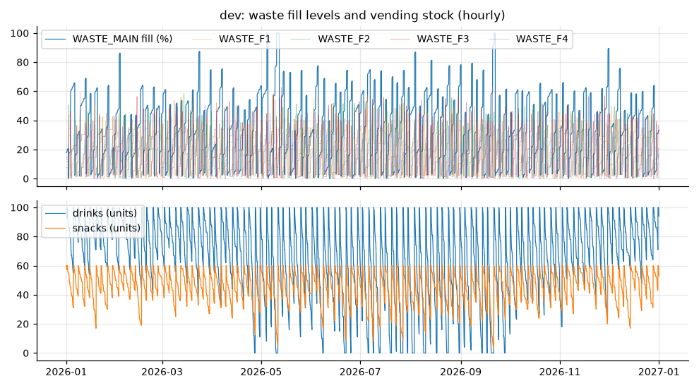

*dev: logistics*

Benign look-alike: a value of 100 % is a cap, so the time at 100 % understates overflow, and a low weekend fill when the hotel is empty is not a sensor fault.

### 5.3 Candidates against corrective work orders

Work orders are written by people after the fact, so they are not ground truth and a detector may not use them before `created_utc`. They are still the best available plausibility check: a corrective order on the same asset shortly after a candidate supports it.

`quickstart`: 4 of 4 corrective orders (excluding guest-reported defects) have a candidate on the same asset in the 14 d before; the 1 metering order(s) are meter exchanges, not faults.

| work order | created (UTC) | asset | summary | candidate kinds | candidate start to work order (h) |
|---|---|---|---|---|---|
| WO00003 | 2026-01-13T22:30Z | R104 | Burst flexible hose under washbasin replaced; floor dried; room inspec | loud_room_night_volume | 23.5 |
| WO00004 | 2026-01-15T05:15Z | WM_R403 | Water meter WM_R403 exchanged (calibration interval) | none | - |
| WO00007 | 2026-01-17T23:00Z | HP1 | Heat pump service: refrigerant leak sealed and recharged | occupied_comfort_deficit | 120.0 |
| WO00008 | 2026-01-23T04:15Z | AHU1 | Heavily loaded AHU1 filters replaced (unplanned) | filter_dp_data_gap, filter_dp_high | 149.8 |
| WO00009 | 2026-01-25T21:45Z | R305 | Toilet fill valve replaced (continuous running) | persistent_room_night_flow | 142.8 |

`dev`: 9 of 9 corrective orders (excluding guest-reported defects) have a candidate on the same asset in the 14 d before; the 2 metering order(s) are meter exchanges, not faults.

| work order | created (UTC) | asset | summary | candidate kinds | candidate start to work order (h) |
|---|---|---|---|---|---|
| WO00006 | 2026-01-27T07:00Z | HP1 | Heat pump service: refrigerant leak sealed and recharged | cop_below_outdoor_fit, occupied_comfort_deficit | 56.0 |
| WO00016 | 2026-03-20T20:15Z | R201 | Burst flexible hose under washbasin replaced; floor dried; room inspec | loud_room_night_volume | 21.2 |
| WO00031 | 2026-06-28T09:00Z | R403 | Toilet fill valve replaced (continuous running) | persistent_room_night_flow | 179.0 |
| WO00035 | 2026-07-01T21:00Z | WM_R105 | Water meter WM_R105 exchanged (calibration interval) | none | - |
| WO00040 | 2026-07-18T10:30Z | WM_MAIN | Leak on DHW circulation pipe in technical room repaired | night_gap_main_minus_rooms | 180.5 |
| WO00042 | 2026-07-29T01:00Z | AHU1 | Heavily loaded AHU1 filters replaced (unplanned) | filter_dp_data_gap, filter_dp_high | 195.0 |
| WO00044 | 2026-08-17T18:45Z | R401 | Burst flexible hose under washbasin replaced; floor dried; room inspec | loud_room_night_volume | 20.8 |
| WO00063 | 2026-10-24T04:00Z | AHU1 | Heavily loaded AHU1 filters replaced (unplanned) | filter_dp_data_gap, filter_dp_high | 222.0 |
| WO00068 | 2026-11-17T07:45Z | R208 | Toilet fill valve replaced (continuous running) | persistent_room_night_flow | 152.8 |
| WO00073 | 2026-12-08T12:00Z | HP1 | Heat pump service: refrigerant leak sealed and recharged | cop_below_outdoor_fit, occupied_comfort_deficit | 277.0 |
| WO00074 | 2026-12-16T19:30Z | WM_R405 | Water meter WM_R405 exchanged (calibration interval) | none | - |

## 6. Normal-operation baselines

Hypotheses: (a) most room meters show zero flow in at least one night interval on almost every night, so a non-zero floor is rare; (b) daily heat demand is explained mostly by heating degree-days, with a smaller occupancy term; (c) a human room cleaning takes a stable time per resource, so readiness can be predicted from the queue.

### 6.1 `quickstart`

Night water per room (01:00-05:00 local), excluding 8 room-nights inside S02 candidates. Across rooms the median share of nights with a zero 15-minute floor is 100.0 % (lowest room 100.0 %). Night volume p95 is 24.0 L for occupied and 6.0 L for vacant room-nights (median over rooms).

Night water baseline per room

| room | nights | zero floor (%) | p50 night volume (L) | p95 night volume (L) | p95 occupied (L) | p95 vacant (L) |
|---|---|---|---|---|---|---|
| R101 | 21 | 100.0 | 0.0 | 56.5 | 25.1 | 41.1 |
| R102 | 21 | 100.0 | 0.0 | 4.5 | 4.5 | 36.9 |
| R103 | 21 | 100.0 | 0.0 | 6.0 | 8.7 | 0.3 |
| R104 | 19 | 100.0 | 0.0 | 6.0 | 6.2 | 6.0 |
| R105 | 21 | 100.0 | 0.0 | 9.0 | 9.7 | 4.5 |
| R106 | 21 | 100.0 | 0.0 | 8.6 | 53.1 | 5.9 |
| R107 | 21 | 100.0 | 0.0 | 8.4 | 37.4 | 4.9 |
| R108 | 21 | 100.0 | 0.0 | 4.5 | 0.2 | 38.4 |
| R109 | 21 | 100.0 | 0.0 | 23.1 | 27.7 | 12.0 |
| R110 | 21 | 100.0 | 0.0 | 58.6 | 36.1 | 45.6 |
| R201 | 21 | 100.0 | 0.0 | 6.0 | 8.0 | 0.0 |
| R202 | 21 | 100.0 | 0.0 | 41.8 | 52.8 | 5.8 |
| R203 | 21 | 100.0 | 0.0 | 6.0 | 7.1 | 4.8 |
| R204 | 21 | 100.0 | 0.0 | 47.8 | 36.7 | 31.7 |
| R205 | 21 | 100.0 | 0.0 | 12.0 | 30.0 | 0.0 |
| R206 | 21 | 100.0 | 6.0 | 56.0 | 61.3 | 6.7 |
| R207 | 21 | 100.0 | 0.0 | 6.0 | 5.3 | 6.6 |
| R208 | 21 | 100.0 | 0.0 | 6.1 | 33.4 | 3.8 |
| R209 | 21 | 100.0 | 0.0 | 12.5 | 33.6 | 12.1 |
| R210 | 21 | 100.0 | 0.0 | 91.1 | 112.2 | 31.5 |
| R301 | 21 | 100.0 | 0.0 | 6.0 | 4.5 | 37.6 |
| R302 | 21 | 100.0 | 0.0 | 4.1 | 4.2 | 1.6 |
| R303 | 21 | 100.0 | 0.0 | 35.4 | 36.9 | 22.9 |
| R304 | 21 | 100.0 | 0.0 | 12.0 | 12.0 | 20.3 |
| R305 | 15 | 100.0 | 0.0 | 7.3 | 7.6 | 4.2 |
| R306 | 21 | 100.0 | 0.0 | 56.5 | 67.1 | 0.0 |
| R307 | 21 | 100.0 | 0.0 | 74.8 | 75.7 | 10.8 |
| R308 | 21 | 100.0 | 0.0 | 6.0 | 8.0 | 3.4 |
| R309 | 21 | 100.0 | 0.0 | 10.5 | 9.2 | 63.5 |
| R310 | 21 | 100.0 | 0.0 | 10.4 | 22.9 | 0.0 |
| R401 | 21 | 100.0 | 1.7 | 53.0 | 54.5 | 1.2 |
| R402 | 21 | 100.0 | 0.0 | 72.8 | 26.9 | 60.5 |
| R403 | 21 | 100.0 | 0.0 | 6.8 | 0.9 | 34.7 |
| R404 | 21 | 100.0 | 0.0 | 10.5 | 43.9 | 4.5 |
| R405 | 21 | 100.0 | 0.0 | 6.0 | 3.1 | 6.0 |
| R406 | 21 | 100.0 | 0.0 | 15.0 | 40.2 | 5.9 |
| R407 | 21 | 100.0 | 0.0 | 42.3 | 45.7 | 7.1 |
| R408 | 21 | 100.0 | 0.0 | 1.3 | 10.8 | 1.0 |
| R409 | 21 | 100.0 | 0.0 | 7.0 | 7.9 | 3.6 |
| R410 | 21 | 100.0 | 0.9 | 12.4 | 10.4 | 58.2 |

Daily heat model: heat_kWh = 167.2 + 36.26 x HDD(18 degC) + 8.25 x occupied rooms, R^2 = 0.822 over 21 days.

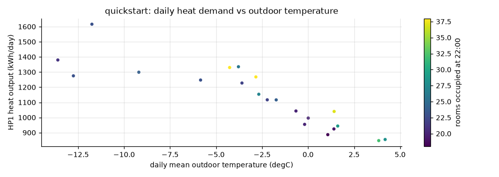

*quickstart: heat demand baseline*

Task durations (minutes, matched start to completion):

| kind | resource | tasks | median | p90 | max |
|---|---|---|---|---|---|
| robot_floor | ROBOT_1 | 110 | 30.0 | 30.0 | 30.0 |
| robot_floor | ROBOT_2 | 70 | 30.0 | 30.0 | 30.0 |
| room | CLEANER_1 | 86 | 45.0 | 52.5 | 60.0 |
| room | CLEANER_2 | 75 | 45.0 | 60.0 | 75.0 |
| room | CLEANER_3 | 52 | 45.0 | 60.0 | 60.0 |

Check-out to next completed room cleaning: median 1.50 h, p90 4.75 h, over 215 check-outs.

### 6.2 `dev`

Night water per room (01:00-05:00 local), excluding 21 room-nights inside S02 candidates. Across rooms the median share of nights with a zero 15-minute floor is 100.0 % (lowest room 100.0 %). Night volume p95 is 45.9 L for occupied and 8.0 L for vacant room-nights (median over rooms).

Night water baseline per room

| room | nights | zero floor (%) | p50 night volume (L) | p95 night volume (L) | p95 occupied (L) | p95 vacant (L) |
|---|---|---|---|---|---|---|
| R101 | 365 | 100.0 | 0.0 | 52.3 | 59.3 | 12.6 |
| R102 | 365 | 100.0 | 0.0 | 54.4 | 57.9 | 6.7 |
| R103 | 365 | 100.0 | 0.0 | 40.8 | 50.5 | 9.5 |
| R104 | 365 | 100.0 | 0.0 | 12.0 | 15.0 | 6.0 |
| R105 | 365 | 100.0 | 0.0 | 50.1 | 58.4 | 7.4 |
| R106 | 365 | 100.0 | 0.0 | 54.2 | 60.6 | 6.0 |
| R107 | 365 | 100.0 | 0.0 | 26.4 | 45.8 | 6.0 |
| R108 | 365 | 100.0 | 0.0 | 38.8 | 40.8 | 17.2 |
| R109 | 365 | 100.0 | 0.0 | 46.2 | 45.9 | 31.4 |
| R110 | 365 | 100.0 | 0.0 | 45.6 | 53.0 | 7.7 |
| R201 | 363 | 100.0 | 0.0 | 10.5 | 12.0 | 6.3 |
| R202 | 365 | 100.0 | 0.0 | 55.4 | 65.4 | 15.8 |
| R203 | 365 | 100.0 | 0.0 | 43.2 | 54.7 | 6.0 |
| R204 | 365 | 100.0 | 0.0 | 11.0 | 12.0 | 5.8 |
| R205 | 365 | 100.0 | 0.0 | 22.2 | 53.0 | 6.0 |
| R206 | 365 | 100.0 | 0.0 | 32.0 | 37.4 | 10.6 |
| R207 | 365 | 100.0 | 0.0 | 13.8 | 31.2 | 8.6 |
| R208 | 357 | 100.0 | 0.0 | 50.6 | 60.6 | 6.0 |
| R209 | 365 | 100.0 | 0.0 | 11.1 | 11.3 | 6.2 |
| R210 | 365 | 100.0 | 0.0 | 19.3 | 32.7 | 10.4 |
| R301 | 364 | 100.0 | 0.0 | 39.5 | 58.0 | 10.5 |
| R302 | 364 | 100.0 | 0.0 | 12.0 | 52.7 | 6.0 |
| R303 | 364 | 100.0 | 0.0 | 31.6 | 41.7 | 8.7 |
| R304 | 364 | 100.0 | 0.0 | 50.2 | 53.8 | 10.0 |
| R305 | 364 | 100.0 | 0.0 | 17.1 | 28.1 | 9.8 |
| R306 | 364 | 100.0 | 0.0 | 35.4 | 50.0 | 4.6 |
| R307 | 364 | 100.0 | 0.0 | 10.3 | 16.8 | 6.8 |
| R308 | 364 | 100.0 | 0.0 | 57.4 | 67.4 | 6.0 |
| R309 | 364 | 100.0 | 0.0 | 44.6 | 55.9 | 6.0 |
| R310 | 364 | 100.0 | 0.0 | 20.3 | 38.7 | 6.0 |
| R401 | 363 | 100.0 | 0.0 | 12.0 | 12.2 | 10.5 |
| R402 | 365 | 100.0 | 0.0 | 50.7 | 56.2 | 23.0 |
| R403 | 356 | 100.0 | 0.0 | 39.9 | 45.8 | 6.0 |
| R404 | 365 | 100.0 | 0.0 | 13.3 | 13.9 | 8.8 |
| R405 | 365 | 100.0 | 0.0 | 17.3 | 17.9 | 16.7 |
| R406 | 365 | 100.0 | 0.0 | 25.7 | 35.9 | 8.4 |
| R407 | 365 | 100.0 | 0.0 | 39.1 | 47.7 | 9.0 |
| R408 | 365 | 100.0 | 0.0 | 35.3 | 47.3 | 10.9 |
| R409 | 365 | 100.0 | 0.0 | 38.3 | 45.0 | 6.0 |
| R410 | 365 | 100.0 | 0.0 | 34.8 | 38.8 | 16.9 |

Daily heat model: heat_kWh = -41.1 + 51.66 x HDD(18 degC) + 5.02 x occupied rooms, R^2 = 0.994 over 365 days.

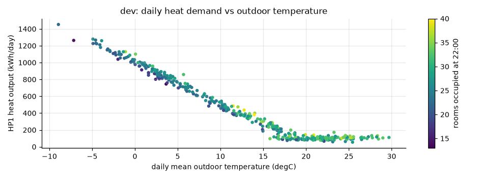

*dev: heat demand baseline*

Task durations (minutes, matched start to completion):

| kind | resource | tasks | median | p90 | max |
|---|---|---|---|---|---|
| robot_floor | ROBOT_1 | 1,868 | 30.0 | 30.0 | 30.0 |
| robot_floor | ROBOT_2 | 1,235 | 30.0 | 30.0 | 30.0 |
| room | CLEANER_1 | 1,553 | 45.0 | 60.0 | 75.0 |
| room | CLEANER_2 | 1,282 | 45.0 | 60.0 | 75.0 |
| room | CLEANER_3 | 879 | 45.0 | 60.0 | 75.0 |

Check-out to next completed room cleaning: median 1.25 h, p90 2.00 h, over 3714 check-outs.

## 7. Seasonality (dev only)

Hypotheses: heating demand and HP efficiency follow outdoor temperature; summer brings overheating because the plant is heating-only; water use follows occupancy; each scenario class occurs several times with varying severity.

| month | outdoor (degC) | HP heat (MWh) | COP (-) | PV (MWh) | load (MWh) | rooms occupied | water (m3/day) | occupied >26 degC (room-h) | comfort deficit (room-h) | hot requests | cold requests |
|---|---|---|---|---|---|---|---|---|---|---|---|
| 1 | -1.4 | 33.17 | 2.54 | 2.10 | 22.10 | 21.7 | 3.7 | 0 | 62 | 0 | 6 |
| 2 | 2.2 | 25.05 | 2.88 | 2.70 | 17.02 | 22.9 | 3.8 | 0 | 38 | 0 | 2 |
| 3 | 4.8 | 23.78 | 3.13 | 3.69 | 16.80 | 25.2 | 4.1 | 0 | 41 | 0 | 3 |
| 4 | 12.1 | 12.20 | 3.55 | 4.54 | 12.52 | 26.8 | 4.4 | 0 | 38 | 0 | 2 |
| 5 | 18.4 | 4.78 | 3.86 | 7.13 | 11.22 | 28.7 | 4.8 | 0 | 437 | 0 | 0 |
| 6 | 22.9 | 2.78 | 4.33 | 8.68 | 10.34 | 29.1 | 4.6 | 4,092 | 16 | 42 | 0 |
| 7 | 25.2 | 3.43 | 4.49 | 7.20 | 11.08 | 32.2 | 5.7 | 15,060 | 0 | 159 | 0 |
| 8 | 18.8 | 4.48 | 3.99 | 6.54 | 10.86 | 30.6 | 5.1 | 156 | 597 | 0 | 0 |
| 9 | 15.6 | 7.88 | 3.75 | 5.87 | 11.71 | 31.9 | 5.7 | 0 | 382 | 0 | 1 |
| 10 | 12.7 | 11.66 | 3.59 | 3.48 | 13.21 | 27.0 | 4.6 | 0 | 35 | 0 | 4 |
| 11 | 8.4 | 17.65 | 3.22 | 1.87 | 14.33 | 24.4 | 4.2 | 0 | 172 | 0 | 4 |
| 12 | 1.2 | 29.52 | 2.74 | 1.48 | 20.21 | 25.0 | 4.0 | 0 | 90 | 0 | 7 |

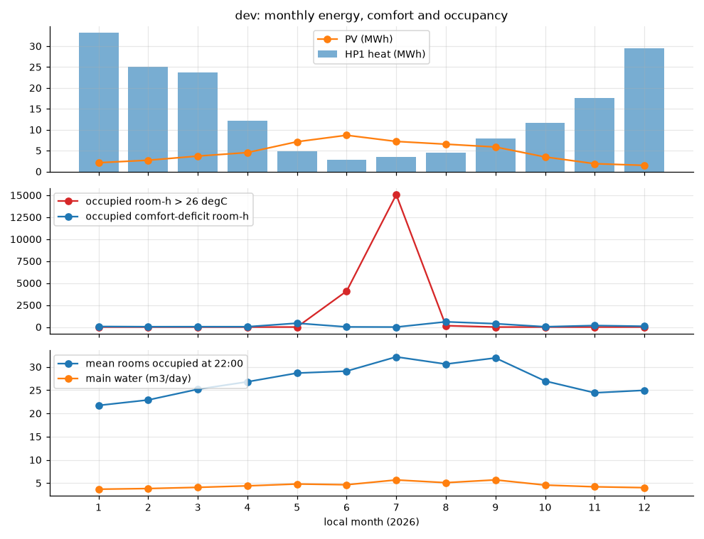

*dev: seasonality*

Overheating peaks in month 7 with 15,060 occupied room-hours above 26 degC; the plant has no cooling (building.json `operations.cooling`).

Comfort deficits in May-Sep: 1,432 room-h, of which 470 room-h fall between 00:00 and 06:00 local (32.8 %, against 25.0 % if spread evenly over the day). The data does not show the cause (open question 6).

Candidate counts per class and local month (section 5 screens):

| class | 1 | 2 | 3 | 4 | 5 | 6 | 7 | 8 | 9 | 10 | 11 | 12 | total |
|---|---|---|---|---|---|---|---|---|---|---|---|---|---|
| LOG fill_at_cap | 0 | 0 | 0 | 0 | 2 | 0 | 0 | 0 | 1 | 0 | 0 | 0 | 3 |
| LOG vending_out_of_stock | 0 | 0 | 0 | 1 | 1 | 3 | 6 | 5 | 4 | 0 | 0 | 0 | 20 |
| LOG waste_bin_full | 0 | 0 | 0 | 0 | 2 | 0 | 0 | 0 | 1 | 0 | 0 | 0 | 3 |
| S01 guest_waited_for_room | 1 | 2 | 0 | 1 | 8 | 1 | 2 | 0 | 8 | 0 | 1 | 0 | 24 |
| S02 loud_room_night_volume | 0 | 0 | 1 | 0 | 0 | 0 | 0 | 1 | 0 | 0 | 0 | 0 | 2 |
| S02 night_gap_main_minus_rooms | 0 | 0 | 0 | 0 | 0 | 0 | 1 | 0 | 0 | 0 | 0 | 0 | 1 |
| S02 persistent_room_night_flow | 0 | 0 | 0 | 0 | 0 | 1 | 0 | 0 | 0 | 0 | 1 | 0 | 2 |
| S03 cop_below_outdoor_fit | 1 | 0 | 0 | 0 | 0 | 0 | 0 | 0 | 0 | 0 | 0 | 1 | 2 |
| S03 occupied_comfort_deficit | 1 | 0 | 0 | 0 | 2 | 1 | 0 | 3 | 3 | 1 | 1 | 1 | 13 |
| S04 filter_dp_data_gap | 0 | 0 | 0 | 0 | 0 | 0 | 1 | 0 | 0 | 1 | 0 | 0 | 2 |
| S04 filter_dp_high | 0 | 0 | 0 | 0 | 0 | 0 | 1 | 0 | 0 | 1 | 0 | 0 | 2 |
| S05 absence_on_weekend | 0 | 1 | 1 | 2 | 0 | 2 | 0 | 0 | 0 | 1 | 2 | 0 | 9 |
| S05 surge_and_absence | 0 | 0 | 0 | 0 | 1 | 0 | 0 | 0 | 1 | 0 | 0 | 0 | 2 |

## 8. Implications for detector design

Each item is a design hypothesis for the detectors, with the evidence above that supports it. Numbers refer to `dev` unless stated.

1. **Room leak = persistence, not magnitude.** Outside S02 candidates, the median room has a zero 15-minute night interval on 100.0 % of nights (lowest room 100.0 %). A night with flow in every interval is therefore abnormal on its own; two such nights in a row gave 2 persistent candidates, 2 of them followed within 14 d by a corrective order on the same room (Toilet fill valve replaced (continuous running)). Evidence: sections 5 and 6.
2. **Burst = volume in a vacant or sleeping room.** A night volume of >= 300 L found 2 candidates, 2 of them followed by a corrective order on the same room (Burst flexible hose under washbasin replaced; floor dried; room inspected). A daytime burst would escape a night-only window, so the detector should also test sustained high flow in a vacant room at any hour.
3. **Leaks outside rooms show only in the main-minus-rooms gap at night.** The p95 of the median night gap on normal nights is 1.4 L/h; on the 1 gap candidate(s) the median night gap is 27.8 L/h. Daily gap totals are confounded by the every-other-day common-area draw (section 5) and must not be used.
4. **Heat pump degradation needs a reference curve from outside the window.** On dev, COP = 2.78 + 0.068 x outdoor degC (Theil-Sen) and 2 low-COP candidates precede refrigerant-leak work orders. On quickstart the same screen, fitted on its own 21 days, finds 0 because the cold spell and the degradation coincide; against the dev curve the quickstart minimum daily COP ratio is 0.81. A detector should carry a fixed reference curve plus the comfort-deficit and lockout signals, and must not refit on the window it judges.
5. **Comfort is judged against the setpoint and occupancy, not the band alone.** Vacant setback rooms and guests who chose a low setpoint are below 20 degC by design; requiring a 1.5 K shortfall in an occupied room with the window closed isolates plant problems (section 5, S03).
6. **Filter degradation: day-mode only, fan power as the second signal.** Night (setback) filter dp is 0.51 times the day-mode median and dp has multi-day gaps; fan power keeps reporting and rises through the gap until it hits its ceiling, then airflow falls (section 5, S04). A dp gap is reported as `data_quality`, never as recovery.
7. **BMS alarms corroborate; they never trigger alone.** Room and comm-loss alarms lag their condition by a median 0.75 h; 19 raised alarms have no supporting telemetry; 914 of 1,077 low-temperature episodes of 1 h or more raise no alarm (section 4).
8. **Gateway outages are one data-quality episode per floor**, not ten room incidents: whole-floor blanks are the signature (section 2). Rooms in an outage get lower confidence and deferred verdicts, never a zero reading.
9. **Turnaround readiness is predictable from the queue.** A human room cleaning takes a median 45 min (p90 60 min); waits cluster on weekends with near-full occupancy and a sick cleaner (sections 5 and 6). Capacity is cleaners present times shift length over the per-room time; robots shorten it but never release a room.
10. **Plan S05 at notice time.** Bookings are created a median 12.0 d before arrival and sick notes arrive 0.5 to 9.0 h before the shift (section 4); 2 of 13 robot out-of-service rows became known only after the shift had started. The weekend plan is re-run whenever a roster row becomes known, not when guests start waiting.
11. **Local time everywhere.** Arrivals, tariffs, forecasts and shifts follow Europe/Vienna across DST (section 2); all windows (night, check-in 15:00, shift 07:00-15:30) are computed in local time from UTC.

Risks for the holdout:

- Few instances per class (section 7): leak, heat pump and filter screens rest on 1 to 2 dev episodes per kind. Prefer rules with physical meaning (zero night floor, setpoint shortfall) over fitted cut-offs.
- A short holdout window, or one inside a cold spell, breaks any baseline fitted on the holdout itself (item 4).
- New codes (HP1 status, alarm codes, resource IDs) and documented-but-absent values (`inspection_required`) can appear; the loader must accept and report them, not crash.
- Data-quality traps seen here will recur in new places: duplicates, a frozen sensor, an isolated 85 degC room temperature, meter exchange with jitter, multi-day dp gaps.
- Screens in this report use hindsight; a detector restricted to information known at decision time will fire later than the candidate starts listed here.

## 9. Open questions for the case mentor

1. Code freeze: `CHALLENGE.md` section 10 says Saturday 14:00 sharp; other channels say 15:00. Which is binding for the repository and for `decisions_holdout.jsonl`?
2. Cancellations: `bookings.csv` has `created_utc` but no time at which a cancellation became known. May we treat a cancellation as known from `created_utc`, or must we treat it as unknown until the arrival time?
3. Scoring: how does the automated check match a decision to an incident (asset, time window, `issue_type` string, `episode_id`)? Do routine autonomous decisions (battery schedule, setpoints) count toward alert spam?
4. Holdout: same `building.json`, same length and season as dev, or a shorter window? This decides whether detectors may fit any baseline on the holdout itself.
5. BMS alarms: are the rule thresholds and the 45-minute lag intended? Are `SENSOR_COMM_LOSS` alarms without missing telemetry deliberate false alarms?
6. Shoulder-season comfort: occupied rooms fall well below their setpoint mostly in May, August, September (section 7). Is heating switched off or limited by a season or night-flushing rule in the simulator, and is that an intended S03 instance?
7. `building.json` declares HP1 metric `cop`, which never appears in `equipment.csv`. Is COP meant to be derived (heat output over electric input)?
8. Room release: the rules require `inspection_passed_if_required`, but `inspection_required` never occurs and no inspection event exists. Is `clean` after `cleaning_completed` sufficient to release, and who may inspect?
9. IDs outside `building.json` appear in events: `MUNICIPAL_SERVICE`, `VENDOR_EXT`, `housekeeping`. May decisions reference them in `affected_assets` or `resource_id`?
10. Robots carrying bins are marked 'not used in current operations'. May our planner dispatch them for bins, and is the 20-minute carry time binding?
11. On-call housekeeper `ONCALL_1` has no roster rows. Is it always available 15:30-22:00 local, and how is its cost to be represented (approval needed)?
12. Attribution: the dataset README writes 'Proximata Hackathon '26 – Rhomberg track'. Should the README attribution reproduce this string exactly?
